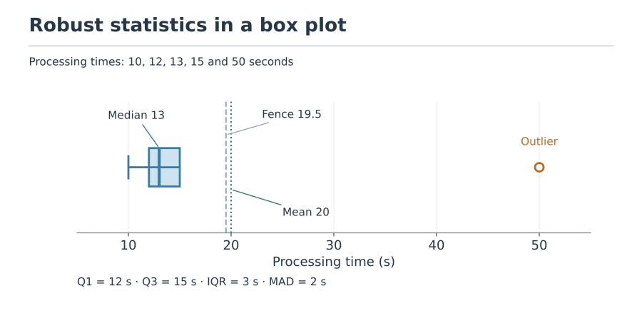

# M5-L2 – Distributions, quantiles and robust statistics {#L2}

**Course area:** M5 – Exploratory data analysis and visualisation

**Level:** Bachelor · Core/Fundamentals

**Prerequisites:** [M4-L2](M4-L2.md) to [M4-L4](M4-L4.md); [M5-L1](M5-L1.md).

**Learning objective:** Describe empirical distributions, calculate quantiles and distinguish robust statistics from those sensitive to outliers.

## Empirical distribution {#S1}

A list of observed numbers can vary simultaneously in location, spread and shape. The empirical distribution function of a sample $x_1,\ldots,x_n$ is

$$\widehat F_n(t)=\frac{1}{n}\sum_{i=1}^n \mathbf{1}\{x_i\leq t\}.$$

The indicator counts each value that is at most $t$. For the sorted processing times 10, 12, 13, 15, 50 s, $\widehat F_5(13)=3/5=0.6$. The empirical function jumps at every observed value; tied values produce a larger jump. It describes the available data rather than providing exact knowledge of the underlying distribution.

## Quantiles and robust location {#S2}

A quantile separates sorted observations according to rank. For this example, we use linear interpolation with index $h=(n-1)p$ for $0\leq p\leq1$ and zero-based indices. If $h$ falls between two indices, interpolate according to its fractional part. This is not the only convention; the method selected in software must therefore be documented.

For five values, $Q_1=x_{(2)}=12$, $Q_2=x_{(3)}=13$ and $Q_3=x_{(4)}=15$ s (here ranks start at one). The interquartile range is $IQR=Q_3-Q_1=3$ s. The median absolute deviation $MAD=\operatorname{median}(|x_i-\operatorname{median}(x)|)$ can be used as a robust measure of spread. The deviations are 3, 1, 0, 2, 37; their median is 2 s. The unscaled MAD is not the same as the standard deviation.

## Sensitivity of statistics {#S3}

*Figure: Robust statistics in a box plot.*

The arithmetic mean is 20 s. It exceeds the median because the largest value has a strong influence. If only 50 is replaced by 100, the mean increases to 30 s, while the median, IQR and MAD remain unchanged. Robust measures are nevertheless not immune to arbitrarily many erroneous observations. A box plot shows the median, quartiles and, according to a specified convention, outer values; the Tukey fences in the example are $12-1.5\cdot3=7.5$ and $15+1.5\cdot3=19.5$ s. The whiskers end at 10 and 15 s, and 50 s is displayed separately. The fences are a diagnostic aid, not proof of errors.

## Exercise and solution {#S4}

Replace 50 in the example with 20. Calculate the mean, median, IQR and MAD. Which values would the Tukey rule flag as unusual?

Solution: mean 14 s, median 13 s, IQR 3 s and MAD 2 s. The fences remain 7.5 and 19.5 s. The new maximum of 20 would therefore also be shown separately. The box plot does not assess the substantive situation, only the distance from the middle half of the sample.

## Sources and further reading {#S5}

- [Wickham, Çetinkaya-Rundel and Grolemund: R for Data Science (2e), Chapter 10: Exploratory data analysis](https://r4ds.hadley.nz/EDA) – **Verification:** pending.
- [NIST/SEMATECH e-Handbook: The Role of Graphics, Section 1.1.5](https://www.itl.nist.gov/div898/handbook/eda/section1/eda15.htm) – **Verification:** pending.
