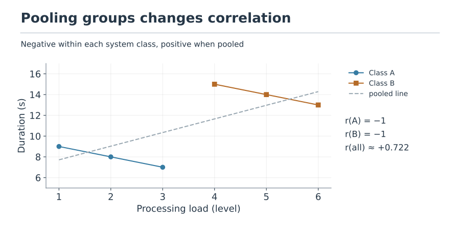

# M5-L3 – Relationships, correlation and confounding {#L3}

**Course area:** M5 – Exploratory data analysis and visualisation

**Level:** Bachelor · Core/Fundamentals

**Prerequisites:** [M1-L5](M1-L5.md); [M4-L4](M4-L4.md); [M5-L2](M5-L2.md).

**Learning objective:** Describe linear and monotonic relationships and recognise the effect of pooling groups.

## Considering two variables together {#S1}

For paired observations $(x_i,y_i)$, a scatter plot addresses whether certain values of $x$ tend to occur with certain values of $y$. When both quantities have positive variability, the Pearson correlation coefficient is

$$r=\frac{\sum_i(x_i-\bar x)(y_i-\bar y)}{\sqrt{\sum_i(x_i-\bar x)^2\sum_i(y_i-\bar y)^2}}.$$

It lies between −1 and 1 and measures linear association. Shifting all values or scaling them by a positive factor does not change it. If a variable is constant, $r$ is undefined. A strong curved relationship may nevertheless have $r=0$, for example $y=x^2$ with symmetric $x$ values. Spearman correlation is the Pearson correlation of the ranks (using average ranks for ties); it can capture monotonic, nonlinear relationships more effectively, but does not detect every dependence.

## When groups reverse the sign {#S2}

*Figure: Pooling groups changes correlation.*

A synthetic experiment observes processing load $x$ and duration $y$ in two system classes. In class A, the pairs are (1,9), (2,8), (3,7); in class B, (4,15), (5,14), (6,13). Within both classes, $r=-1$. Calculated across both classes, $r\approx0.722$; the difference between the classes dominates the negative relationship within each class. The graphic preview shows both groups and the pooled line. This reversal of direction is an example of Simpson's paradox in the broad sense.

If system class influences both variables, it is a potential confounder. Stratification can then reveal different relationships. Whether a variable should actually be controlled for depends on the causal structure; conversely, controlling for a common effect of two variables can induce a spurious correlation. The graphic alone establishes neither a cause nor the correct adjustment strategy.

## Robust analysis and interpretation {#S3}

Examine the scatter plot first, then calculate statistics. A single distant point can substantially change Pearson correlation. With repeated observations of a device or temporally dependent data, the points must not simply be treated as independent units for subsequent inference. Correlation is also symmetric: $r(x,y)=r(y,x)$, whereas predicting $y$ from $x$ is a directional task.

## Exercise and solution {#S4}

The values $x=(-2,-1,0,1,2)$ and $y=(4,1,0,1,4)$ come from an error-free quadratic relationship. Why is Pearson correlation nevertheless zero?

Solution: $\bar x=0$, $\bar y=2$, and the terms $x_i(y_i-2)$ are −4, 1, 0, −1 and 4. Their sum is zero, and both variables have positive variability. The result rules out linear association in this sample, not the deterministic relationship.

## Sources and further reading {#S5}

- [Wickham, Çetinkaya-Rundel and Grolemund: R for Data Science (2e), Chapter 10: Exploratory data analysis](https://r4ds.hadley.nz/EDA) – **Verification:** pending.
- [Wilke: Fundamentals of Data Visualization, Chapter 5: Directory of visualizations](https://clauswilke.com/dataviz/directory-of-visualizations.html) – **Verification:** pending.
