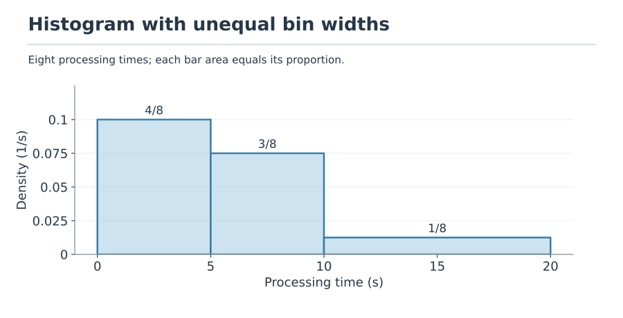

# M5-L4 – Visualisation of numerical and categorical data {#L4}

**Course area:** M5 – Exploratory data analysis and visualisation

**Level:** Bachelor · Core/Fundamentals

**Prerequisites:** [M5-L2](M5-L2.md), [M5-L3](M5-L3.md).

**Learning objective:** Select chart types appropriate to the variables and question, and interpret their scales correctly.

## Measured quantities and visual mapping {#S1}

A graphic maps data values to visual attributes: position, length, colour, shape or area. The choice begins with the question. Bars are suitable for frequencies of nominal categories; a histogram or empirical distribution function is suitable for a numerical distribution. An ordered time axis may be represented by a line. Connecting two unordered categories, by contrast, would suggest an intermediate progression that does not exist. Bar lengths require a zero baseline; for a dot or line chart, a justified and clearly labelled restricted range may be useful.

## Scaling histograms correctly {#S2}

*Figure: Histogram with unequal bin widths.*

With bin boundaries $a_j<b_j$ and counts $c_j$, the normalised histogram height is

$$d_j=\frac{c_j}{n(b_j-a_j)}.$$

The area of a bar therefore corresponds to its relative frequency $c_j/n$. Example: eight processing times of 1, 2, 3, 4, 6, 8, 9, 12 s are divided into [0,5), [5,10) and [10,20). The counts are 4, 3, 1; the densities are 0.1, 0.075 and 0.0125 per second. All areas sum to one. The graphic preview uses these unequal bin widths. If raw counts were used as heights instead, the area of the wide final bin would be disproportionately large. The choice of bin width affects which structures are visible; alternative widths are therefore useful.

## Categories and comparisons {#S3}

For 40 operations in the three categories A, B and C with counts of 18, 14 and 8, the proportions are 45%, 35% and 20%. A bar chart shows their magnitudes on a common scale. When comparing two groups of different sizes, proportions normalised within each group are often more informative than absolute counts. Both quantities matter: proportions show composition, counts show size. Ordinal categories retain their meaningful order, even if the frequency order differs. Labels should specify units, the population or sample size, and any missing cases.

## Exercise and solution {#S4}

A bin [20,30) contains 5 of a total of 50 measurements. What is the height of the density bar? How high would a bar with the same count and twice the width be?

Solution: $5/(50\cdot10)=0.01$ per unit. With width 20, the height is 0.005 per unit; the area is 0.1 in both cases. A bar chart of nominal categories has no such numerical bin widths.

## Sources and further reading {#S5}

- [Wilke: Fundamentals of Data Visualization, Chapter 5: Directory of visualizations](https://clauswilke.com/dataviz/directory-of-visualizations.html) – **Verification:** pending.
- [NIST/SEMATECH e-Handbook: The Role of Graphics, Section 1.1.5](https://www.itl.nist.gov/div898/handbook/eda/section1/eda15.htm) – **Verification:** pending.
