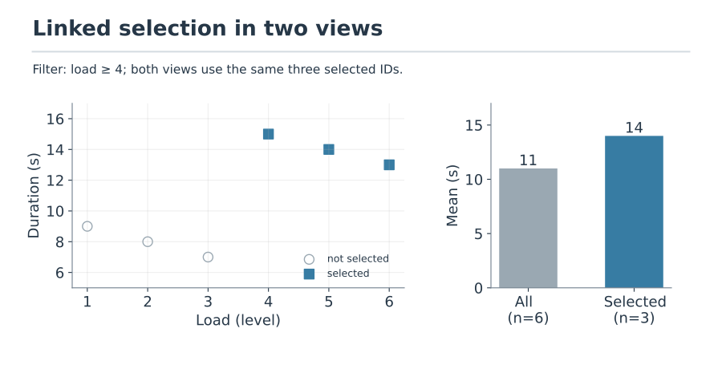

# M5-L5 – Multidimensional data and interactive exploration {#L5}

**Course area:** M5 – Exploratory data analysis and visualisation

**Level:** Bachelor · Core/Fundamentals

**Prerequisites:** [M2-L1](M2-L1.md); [M3-L4](M3-L4.md); [M5-L3](M5-L3.md), [M5-L4](M5-L4.md).

**Learning objective:** Explore multiple variables together using small multiples, colour and shape encoding, and consistent filters.

## More than two features {#S1}

An observation can have numerous variables, such as temperature, load, processing time and device type. A two-dimensional representation can encode load and processing time as coordinates, and type as shape or colour. Further features can be represented using separate panels (facets) rather than ever more visual attributes. Facets with shared axes support comparisons between groups; differing axes must be clearly indicated. With many data points, symbols overlap: transparency, two-dimensional binning or density plots are alternatives.

## The correlation matrix and its limitations {#S2}

For $d$ numerical variables, a full matrix contains $d^2$ entries, including $d(d-1)/2$ distinct pairs. A correlation matrix has ones on the diagonal provided the respective variable is not constant. A diverging colour scale from −1 to +1 with a neutral midpoint at zero keeps signs and strengths comparable. Calculation using pairwise exclusion of missing data may use a different sample for each pair; sample sizes must then be reported. Furthermore, a matrix estimated this way can lose its positive semidefiniteness. A correlation table cannot replace scatter plots: nonlinear and group-specific relationships may remain hidden.

## Filtering, linking and comparing {#S3}

*Figure: Linked selection in two views.*

An interactive dashboard should make selection states visible. Suppose six operations have loads (1,2,3,4,5,6) and durations (9,8,7,15,14,13) as in [M5-L3](M5-L3.md). The filter for load at least 4 highlights three observations. Their mean is 14 s compared with 11 s in the entire sample. A linked second view should highlight the same three IDs rather than silently using a different population. The graphic preview shows the selection in the scatter plot and the mean-value view. The means answer different questions; their difference is not evidence of an intervention effect.

With an interactive time selection, time boundaries and the time zone must remain unambiguous. Filters and aggregation steps should be exportable. For accessible presentation, a combination of shape, text and colour identifies the selection so that it can also be recognised without colour perception.

## Exercise and solution {#S4}

How many distinct variable pairs does a matrix of five features contain? How can the selection of operations with loads from 2 to 4 be documented reproducibly across two charts?

Solution: $5\cdot4/2=10$ pairs. Save the condition $2\leq x\leq4$, the dataset version and the associated observation IDs; this produces three points with durations of 8, 7 and 15 s. Their mean is 10 s. The selected case count must be the same in both views, provided no further exclusions are applied.

## Sources and further reading {#S5}

- [Wilke: Fundamentals of Data Visualization, Chapter 5: Directory of visualizations](https://clauswilke.com/dataviz/directory-of-visualizations.html) – **Verification:** pending.
- [Wickham, Çetinkaya-Rundel and Grolemund: R for Data Science (2e), Chapter 10: Exploratory data analysis](https://r4ds.hadley.nz/EDA) – **Verification:** pending.
