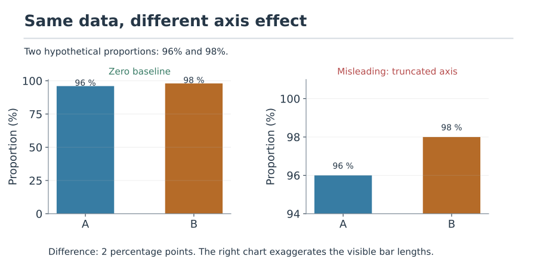

# M5-L6 – Sampling error, misleading graphics and communication {#L6}

**Course area:** M5 – Exploratory data analysis and visualisation

**Level:** Bachelor · Core/Fundamentals

**Prerequisites:** [M4-L7](M4-L7.md); [M5-L4](M5-L4.md), [M5-L5](M5-L5.md).

**Learning objective:** Distinguish sampling variability, systematic bias and visual exaggeration, and communicate results transparently.

## Variability and systematic errors {#S1}

Sampling error in the narrower statistical sense is the random deviation of an estimate from its target value due to sample selection. For independent, identically distributed Bernoulli observations with success probability $p$, the proportion estimator $\hat p$ has standard deviation $\sqrt{p(1-p)/n}$. Substituting the observed proportion for $p$ yields an estimated standard error. With 54 successes in 100 observations, $\hat p=0.54$ and $\widehat{SE}\approx0.0498$. This is nearly five percentage points, not five per cent relative to the estimated proportion. Standard errors and confidence intervals are different (M6).

A voluntary survey can have a biased composition even with very large $n$. More responses reduce random variation under suitable assumptions, but do not automatically remedy selection, measurement or non-response bias. Missing groups must therefore be investigated before interpretation.

## Displays with deceptive scales {#S2}

*Figure: Same data, different axis effect.*

Two hypothetical systems achieve values of 96% and 98%. The difference is 2 percentage points; relative to the first value, it is approximately 2.083%. If a bar chart starts at 94%, the visible bar lengths are 2 and 4 percentage points respectively. This makes the second bar appear twice as long, although the proportion is only slightly greater. The graphic preview contrasts the truncated chart as a negative example with a zero baseline. For a detailed comparison, a dot plot with an explicitly restricted scale may be more suitable.

Unequal time intervals drawn on an equally spaced axis, undisclosed smoothing or a change of denominator can also create a discrepancy between the impression and the data. If uncertainty bars are shown, their meaning (standard deviation, standard error, interval or something else) must be explained immediately.

## A transparent results report {#S3}

First state which population and time period the analysis covers. Distinguish observed findings, uncertainty and your own interpretation. Specify which data were excluded, how units are defined and how statistics were calculated. An exploratory finding can motivate a new hypothesis; a confirmatory investigation then requires appropriate, preferably independent data, or an analysis explicitly labelled as exploratory. Data protection and access rules may limit publication of raw data, but not the need for a transparent description of methods.

## Exercise and solution {#S4}

A proportion increases from 50% to 55% in two independent samples of 100 cases each. Calculate the estimated standard error of the difference under independent Bernoulli sampling. What follows?

Solution: $\sqrt{0.5\cdot0.5/100+0.55\cdot0.45/100}\approx0.0705$. The observed difference of five percentage points is smaller than this estimated standard error. A definite increase cannot be inferred from this; a formal test follows in M6.

## Sources and further reading {#S5}

- [Wilke: Fundamentals of Data Visualization, Chapter 5: Directory of visualizations](https://clauswilke.com/dataviz/directory-of-visualizations.html) – **Verification:** pending.
- [NIST/SEMATECH e-Handbook: The Role of Graphics, Section 1.1.5](https://www.itl.nist.gov/div898/handbook/eda/section1/eda15.htm) – **Verification:** pending.
