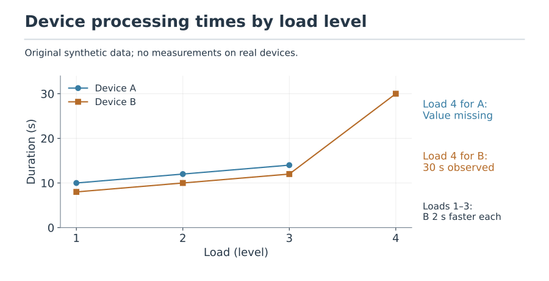

# M5-L7 – Exploratory case study with an original dataset {#L7}

**Course area:** M5 – Exploratory data analysis and visualisation

**Level:** Bachelor · Core/Fundamentals

**Prerequisites:** [M3-L1](M3-L1.md), [M3-L4](M3-L4.md); [M5-L1](M5-L1.md) to [M5-L6](M5-L6.md).

**Learning objective:** Carry out a complete exploratory workflow with documented data checks, group comparisons and appropriately limited conclusions.

## Research question and synthetic data {#S1}

A fictional engineering team investigates processing times of two devices handling orders logged in the same way. The eight records were constructed specifically for this exercise; they do not come from real measurements. Each row is an order; `last` is a dimensionless load level, and `dauer_s` is the duration in seconds. The project question is: what differences appear between devices and load levels, and where are data missing?

| ID | Device | Load | Duration (s) |
|---|---|---:|---:|
| 1 | A | 1 | 10 |
| 2 | A | 2 | 12 |
| 3 | A | 3 | 14 |
| 4 | A | 4 | – |
| 5 | B | 1 | 8 |
| 6 | B | 2 | 10 |
| 7 | B | 3 | 12 |
| 8 | B | 4 | 30 |

ID must be unique, and load and duration must be positive where observed. The missing duration remains unknown; 30 s is unusual, but not automatically invalid.

## Analysis with Python {#S2}

The following program reconstructs the data in full. It requires only pandas and calculates group sizes, valid cases and measures of location. `size` also counts rows without a duration, whereas `count` counts only available durations.

```python
import pandas as pd

df = pd.DataFrame({
    "id": range(1, 9),
    "geraet": ["A"] * 4 + ["B"] * 4,
    "last": [1, 2, 3, 4] * 2,
    "dauer_s": [10, 12, 14, None, 8, 10, 12, 30],
})
assert df["id"].is_unique
assert df["last"].gt(0).all()
assert df["dauer_s"].dropna().gt(0).all()

bericht = df.groupby("geraet")["dauer_s"].agg(
    zeilen="size", gueltig="count",
    mittel="mean", median="median",
)
bericht["fehlquote"] = 1 - bericht.gueltig / bericht.zeilen
print(bericht)

paare = df.pivot(index="last", columns="geraet", values="dauer_s")
differenzen = (paare["A"] - paare["B"]).dropna()
print(differenzen.mean())
```

Device A: three valid values, mean 12 s, median 12 s, missingness rate 25%. Device B: four valid values, mean 15 s, median 11 s, missingness rate 0%. The unpaired mean appears to favour A. At the three shared load levels, however, B is 2 s faster each time; the mean paired difference A minus B is 2 s.

## Graphical analysis and limitations {#S3}




*Figure: Device processing times by load level.*

The graphic preview connects only consecutive observed load levels for each device. A has a visibly missing observation at load 4, while B increases to 30 s. Shared load level 4 must not be interpreted as an equivalently observed comparison. Whether one device is generally faster remains open: there are no repetitions, independent orders or explanations for the missing measurement. The three differences describe only the constructed dataset. For the next data collection, both devices should be measured repeatedly under identical load conditions, with causes of failures recorded.

## Exercise and solution {#S4}

Calculate the overall mean of the valid durations. As a sensitivity analysis, repeat the calculation without the unusual value of 30 s. What may be concluded?

Solution: $(10+12+14+8+10+12+30)/7=96/7\approx13.71$ s. Without 30 s, 66/6=11 s remains. The difference shows the sensitivity of the mean, but not that the removed value is erroneous. Report both scenarios with case counts and keep the raw data unchanged.

## Sources and further reading {#S5}

- [Wickham, Çetinkaya-Rundel and Grolemund: R for Data Science (2e), Chapter 10: Exploratory data analysis](https://r4ds.hadley.nz/EDA) – **Verification:** pending.
- [pandas: Working with missing data (User Guide)](https://pandas.pydata.org/docs/user_guide/missing_data.html) – **Verification:** pending.
- [Wilke: Fundamentals of Data Visualization, Chapter 5: Directory of visualizations](https://clauswilke.com/dataviz/directory-of-visualizations.html) – **Verification:** pending.
