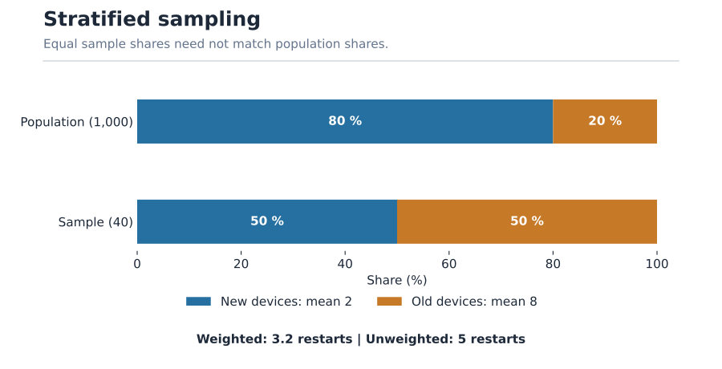

# M6-L1 – Population, sample and selection mechanisms {#L1}

**Course area:** M6 – Statistical inference and experimental design

**Level:** Bachelor · Core/Fundamentals

**Prerequisites:** [M1-L3](M1-L3.md), [M4-L1](M4-L1.md) and [M5-L1](M5-L1.md).

**Learning objective:** Distinguish the target population from the sampling frame and recognise selection bias in an estimation problem.

## Which unit should be represented? {#S1}

An energy supplier wants to determine the average number of restarts of a smart meter per month. The target population comprises all 1,000 devices operated in January. A device is the unit of investigation; a restart is an event within that unit. The sampling frame is the register from which devices can actually be selected. If older devices without remote maintenance are absent from it, even random selection from this register may fail to represent the entire target population.

A parameter describes the target population, whereas a statistic is calculated from observed data. For a finite population with values $y_i$, the target parameter is the mean $\mu=N^{-1}\sum_{i=1}^N y_i$. An estimate is meaningful only once the population, time and characteristic have been clearly defined.

## Selection and weighting {#S2}

*Figure: Stratified sampling.*

In simple random sampling without replacement from $N$ units, every set of $n$ units has the same selection probability. In stratified sampling, the population is divided into disjoint groups and samples are drawn independently within each group. This can ensure adequate representation of small but important groups. Cluster sampling, by contrast, selects entire groups, such as buildings containing several meters; observations within a building may be strongly related.

In the teaching example, 800 devices are new and 200 are old. Twenty devices are randomly selected from each age group. Their observed group means are 2 and 8 restarts respectively. The unweighted mean is 5; the population-weighted result is

$$\hat\mu=0.8\cdot2+0.2\cdot8=3.2.$$

The weights correspond to the proportions of the strata, not their proportions in the sample. Sampling error remains; the graphic shows the different compositions, not the uncertainty. If the sizes $N_h$ are known, the general expression is $\hat\mu=\sum_h (N_h/N)\bar y_h$. Without suitable assumptions about selection, weighting cannot correct unknown differences.

## Systematic errors {#S3}

Self-selection arises, for example, when only operators experiencing problems respond to a form. Non-response can occur after random selection. Both mechanisms can bias the results; simply obtaining more responses does not solve the problem. Record the inclusion rules, non-responses and time of data collection. Check whether a statement is justified only for responding devices or for the entire target population. Independence must be assessed at the level of the unit of investigation; ten measurements from one device do not replace ten independent devices.

## Exercise and solution {#S4}

An installation contains 90% type A and 10% type B; both types occur equally often in a random sample drawn within the strata. The group means are 4 and 14. Calculate both overall means.

Solution: Unweighted $(4+14)/2=9$, stratified $0.9\cdot4+0.1\cdot14=5$. The second value accounts for the actual composition of the installation. Standard errors require knowledge of group sizes, variability within groups and the sampling design.

## Sources and further reading {#S5}

- [OpenIntro Statistics: Chapters 1, 5, 6 and 7 (chapter overview)](https://www.openintro.org/book/os/) – **Verification:** pending.
