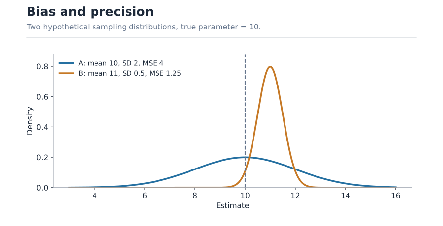

# M6-L2 – Point estimation, bias and standard error {#L2}

**Course area:** M6 – Statistical inference and experimental design

**Level:** Bachelor · Core/Fundamentals

**Prerequisites:** [M4-L4](M4-L4.md), [M4-L5](M4-L5.md) and [M4-L7](M4-L7.md); [M6-L1](M6-L1.md).

**Learning objective:** Distinguish unbiasedness, variance, mean squared error and standard error.

## A rule and its observed value {#S1}

An estimator $T(X_1,\ldots,X_n)$ is a function of random data; after a particular data collection it yields the estimate $t$. Suppose the unknown mean $\mu$ is the quantity of interest. Under independent, identically distributed observations with finite variance $\sigma^2$, the sample mean $\bar X$ has the properties

$$E[\bar X]=\mu,\qquad \operatorname{Var}(\bar X)=\frac{\sigma^2}{n}.$$

The standard error $\operatorname{SE}(\bar X)=\sigma/\sqrt n$ describes the variability of the estimator across repeated samples. It is not the spread of individual observations. When $\sigma$ is unknown, $s/\sqrt n$ is often used; $s$ is the sample standard deviation based on the variance estimate with denominator $n-1$.

## Error across repetitions {#S2}

*Figure: Bias and precision.*

For a scalar target $\theta$, $b=E[T]-\theta$ describes the bias. The mean squared error decomposes as

$$\operatorname{MSE}(T)=E[(T-\theta)^2]=\operatorname{Var}(T)+b^2.$$

This follows because $T-\theta=(T-E[T])+b$; on squaring, the cross term has expectation zero. An unbiased estimator can therefore be imprecise, while a biased estimator can have lower MSE. The graphic shows two hypothetical sampling distributions for $\theta=10$: A has mean 10 and standard deviation 2, while B has mean 11 and standard deviation 0.5. A has MSE 4 and B has MSE 1.25. This does not establish a general preference for biased estimators; the comparison depends on the parameter, loss function and sampling model.

## Precision and sample size {#S3}

Suppose the standard deviation in a study of mean processing time is 12 ms. Under the independent model, $n=36$ gives a standard error of 2 ms and $n=144$ gives one of 1 ms. Four times as many independent observations halve the standard error. By contrast, a constant calibration error of 3 ms does not disappear with more measurements. Consistency means that the estimator approaches the target in probability as sample size grows. Unbiasedness alone does not guarantee this; an unbiased estimator that uses only the first observation typically does not become more precise.

## Exercise and solution {#S4}

One estimator has bias −2 and variance 3; another is unbiased with variance 8. Which has the smaller mean squared error?

Solution: $3+(-2)^2=7$ compared with 8. The first is preferable under this loss function. The unit of MSE is the square of the parameter's unit; its square root (RMSE) has the same unit as the target.

## Sources and further reading {#S5}

- [Penn State STAT 415: Estimation (Part I), Lesson 2](https://online.stat.psu.edu/stat415/Lesson02) – **Verification:** pending.
- [OpenIntro Statistics: Chapters 1, 5, 6 and 7 (chapter overview)](https://www.openintro.org/book/os/) – **Verification:** pending.
