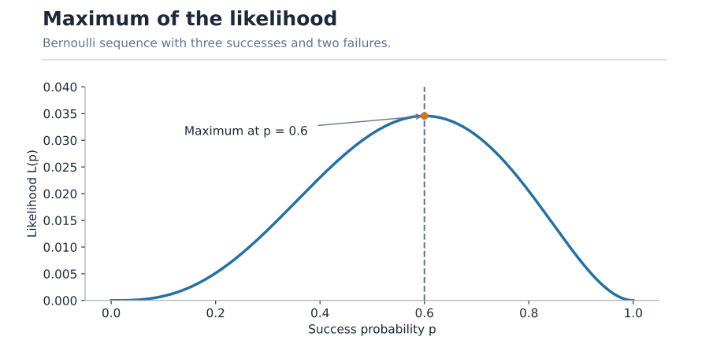

# M6-L3 – Maximum likelihood and the method of moments {#L3}

**Course area:** M6 – Statistical inference and experimental design

**Level:** Bachelor · Core/Fundamentals

**Prerequisites:** [M2-L5](M2-L5.md), [M4-L2](M4-L2.md) to [M4-L5](M4-L5.md); [M6-L2](M6-L2.md).

**Learning objective:** Construct likelihoods and moment equations and compare estimation methods.

## Hold the data fixed and vary the parameter {#S1}

*Figure: Maximum of the likelihood.*

A diagnostic program returns the values 1, 0, 1, 1, 0 in five independent runs under the same conditions (1 denotes success). Under a Bernoulli model with unknown success probability $p$, the probability of exactly this ordered sequence is $L(p)=p^3(1-p)^2$. Viewed as a function of the parameter with the data fixed, it is called the likelihood. It is not a probability distribution over $p$; a Bayesian approach would additionally require a prior distribution.

For $0<p<1$,

$$\ell(p)=\log L(p)=3\log p+2\log(1-p),\qquad \ell'(p)=\frac{3}{p}-\frac{2}{1-p}.$$

The derivative is zero at $\hat p=3/5=0.6$. Since $\ell''(p)=-3/p^2-2/(1-p)^2<0$ and the likelihood is zero at the boundaries, this is the global maximum. The graphic traces $L(p)$ over the parameter space. If all trials succeed or all fail, however, the maximum lies at the boundary $p=1$ or $p=0$ respectively; searching only for interior stationary points is then insufficient.

## Products, logarithms and optimisation {#S2}

For independent data with density or probability mass function $f_\theta$, $L(\theta)=\prod_i f_\theta(x_i)$. The log-likelihood is a sum and reduces numerical underflow problems. For continuous values, the product is of densities, not of probabilities at individual points. Numerical methods often minimise the negative log-likelihood. Parameter bounds, boundary solutions, model identifiability and possible local optima must be checked separately.

## Method of moments and model choice {#S3}

The method of moments equates empirical moments to model moments. For the Bernoulli model, $E[X]=p$ immediately gives $\bar x=\hat p$, the same result as maximum likelihood. For the uniform distribution on $[0,\theta]$, however, $E[X]=\theta/2$. For invented measurements 1, 2 and 6, $\hat\theta_{\mathrm{MM}}=2\bar x=6$. For measurements 1, 1 and 7, the result is also 6, although one measurement would then lie outside the estimated support. For positive data, the likelihood method selects the sample maximum, since $L(\theta)=\theta^{-n}$ for $\theta\ge\max_i x_i$ and zero otherwise. The difference illustrates that algebraically matching moments do not guarantee a valid model fit.

## Exercise and solution {#S4}

Four independent Bernoulli trials yield exactly one success. Write down the log-likelihood and determine its maximum.

Solution: $\ell(p)=\log p+3\log(1-p)$, with derivative $1/p-3/(1-p)=0$ at $p=0.25$. The second derivative is negative, and the likelihood is zero at the boundaries. The method of moments also yields $1/4$.

## Sources and further reading {#S5}

- [Penn State STAT 415: Estimation (Part I), Lesson 2](https://online.stat.psu.edu/stat415/Lesson02) – **Verification:** pending.
- [Penn State STAT 415: Estimation (Part II), Lesson 3](https://online.stat.psu.edu/stat415/Lesson03) – **Verification:** pending.
