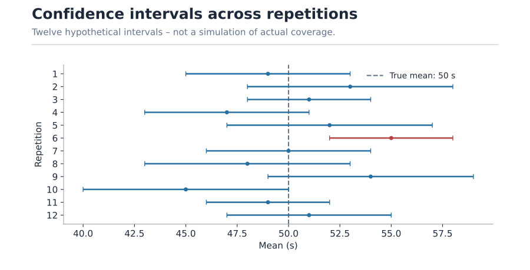

# M6-L4 – Confidence intervals and hypothesis tests {#L4}

**Course area:** M6 – Statistical inference and experimental design

**Level:** Bachelor · Core/Fundamentals

**Prerequisites:** [M4-L7](M4-L7.md); [M6-L2](M6-L2.md).

**Learning objective:** Calculate a t-interval and interpret p-values and coverage probability correctly.

## Intervals offer a repeated-sampling guarantee {#S1}

*Figure: Confidence intervals across repetitions.*

A workshop estimates the mean duration of a testing step. For $n$ independent normally distributed measurements with unknown variance, the two-sided t-confidence interval for the mean is

$$\bar x\pm t_{1-\alpha/2,n-1}\frac{s}{\sqrt n}.$$

Here $t_{q,\nu}$ is the $q$ quantile of the t-distribution with $\nu$ degrees of freedom. Under the stated assumptions, across many repetitions an average of $100(1-\alpha)$ per cent of intervals constructed in this way contain the fixed true parameter. A particular interval either contains it or does not; without an additional probability model for the parameter, this is not a 95% probability for the parameter. The graphic illustrates this distinction with hypothetical intervals.

## An example in seconds {#S2}

Nine independent measurements give $\bar x=52$ s and $s=6$ s. The standard error is 2 s. For $\alpha=0.05$ and eight degrees of freedom, the quantile is approximately 2.306. This gives $52\pm4.612$, or $[47.388;56.612]$ s. The interval estimates the mean, not the duration of a future individual operation; the latter can vary much more widely. For very small, skewed samples or dependent data, the t-method is not automatically reliable.

## From the model to a test decision {#S3}

To ask whether the true mean differs from 50 s, set $H_0:\mu=50$ and $H_1:\mu\ne50$. The test statistic is $t=(52-50)/2=1$. Under the null hypothesis the two-sided p-value is $P(|T_8|\ge1)\approx0.347$. It indicates how often, under $H_0$ and the model, a test statistic at least as extreme would be expected. It is neither the probability that $H_0$ is true nor a measure of the size of the effect. At a pre-specified 5% level, $H_0$ is not rejected here. The fact that 50 lies in the corresponding interval reflects the same decision; equality has not thereby been established. One-sided hypotheses must be justified on substantive grounds before analysis.

## Exercise and solution {#S4}

An independent normally distributed sample of 16 measurements has mean 24 and standard deviation 4. Test $H_0:\mu=27$ using a two-sided test at 5%.

Solution: Standard error 1, $t=-3$, 15 degrees of freedom; the critical quantile is approximately 2.131. $|t|>2.131$, so reject under the model assumptions. The interval $[21.869;26.131]$ excludes 27.

## Sources and further reading {#S5}

- [NIST/SEMATECH e-Handbook: Confidence Limits for the Mean, 1.3.5.2](https://www.itl.nist.gov/div898/handbook/eda/section3/eda352.htm) – **Verification:** pending.
- [OpenIntro: Foundations of inference (tutorial overview)](https://openintrostat.github.io/ims-tutorials/04-foundations/) – **Verification:** pending.
