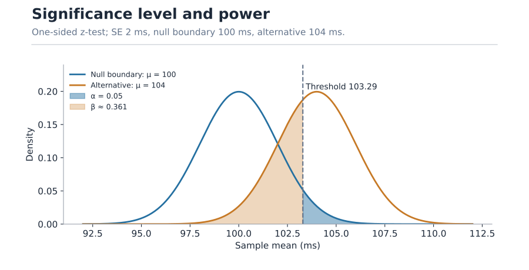

# M6-L5 – Type I and type II errors, power and effect size {#L5}

**Course area:** M6 – Statistical inference and experimental design

**Level:** Bachelor · Core/Fundamentals

**Prerequisites:** [M6-L4](M6-L4.md); [M4-L7](M4-L7.md).

**Learning objective:** Define error rates relative to hypotheses and derive a sample size from a target effect.

## Two possible decision errors {#S1}

For a valid test, the significance level $\alpha$ bounds the probability of incorrectly rejecting the null hypothesis. A type II error, with probability $\beta(\theta)$, consists of failing to reject a false null hypothesis; it depends on the particular parameter value under the alternative. Power is $1-\beta(\theta)$. A non-significant result from a low-power test provides little evidence against a practically important alternative.

## How power arises {#S2}

*Figure: Significance level and power.*

Consider independent normally distributed measurements with known standard deviation $\sigma=10$ ms. A one-sided z-test of $H_0:\mu\le100$ against $H_1:\mu>100$ rejects when $\bar X>100+z_{0.95}\sigma/\sqrt n$. For $n=25$ the boundary is 103.290 ms. Under $\mu=104$ the standard deviation of the sample mean is still 2 ms. Therefore

$$1-\beta(104)=1-\Phi\left(\frac{103.290-104}{2}\right)\approx0.639.$$

$\Phi$ denotes the cumulative distribution function of the standard normal distribution. The graphic represents the two distributions of the means and the different error regions. The smallest meaningful effect must be specified on substantive grounds, for example 4 ms here. Its standardised effect size is $d=4/10=0.4$. A very small but precisely measured effect can be statistically significant and practically irrelevant.

## Sample size planning {#S3}

For the described z-test with desired power $1-\beta$ at $\mu=\mu_0+\delta$, rearranging the normal quantiles gives

$$n\ge\left(\frac{(z_{1-\alpha}+z_{1-\beta})\sigma}{\delta}\right)^2.$$

For $\alpha=0.05$, power 0.8 and $\delta=4$, the unrounded quantiles (approximately 1.645 and 0.842) give a value of 38.64, so at least 39 independent measurements are needed. This is a model-based calculation for a one-sided test with known variance. With unknown variance, two groups, clustering or sequential decisions, the planning must be adapted. Dropouts should also be accounted for. For practically equivalent outcomes, specifically designed equivalence tests with a pre-defined tolerance may be appropriate; an ordinary non-significant test is insufficient.

## Exercise and solution {#S4}

How does the minimum number calculated above change if the intended detectable effect is only 2 ms rather than 4 ms?

Solution: The unrounded requirement quadruples, to approximately 154.56; rounding up gives 155. Doubling the noise while keeping the effect unchanged produces the same factor.

## Sources and further reading {#S5}

- [OpenIntro Statistics: Chapters 1, 5, 6 and 7 (chapter overview)](https://www.openintro.org/book/os/) – **Verification:** pending.
- [OpenIntro: Foundations of inference (tutorial overview)](https://openintrostat.github.io/ims-tutorials/04-foundations/) – **Verification:** pending.
