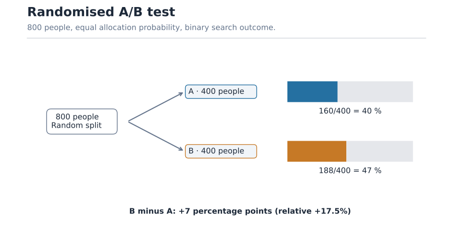

# M6-L6 – Experimental design, randomisation and A/B tests {#L6}

**Course area:** M6 – Statistical inference and experimental design

**Level:** Bachelor · Core/Fundamentals

**Prerequisites:** [M1-L5](M1-L5.md); [M6-L1](M6-L1.md), [M6-L4](M6-L4.md) and [M6-L5](M6-L5.md).

**Learning objective:** Specify the randomisation unit, outcome measure and analysis plan of an A/B experiment.

## What should be changed? {#S1}

A software team wants to test whether a revised search function more often helps users find a desired document. Version A remains unchanged; version B differs only in the intended feature. The target population, success criterion (e.g. at least one suitable document within 60 s), time period and smallest relevant effect must be determined in advance. Other measures such as crashes or processing time may serve as guardrail metrics. The result of a test applies first to the defined population and the observed usage scenario.

## Allocation and comparability {#S2}

Participants are randomly allocated to the variants in a 1:1 ratio. The randomisation unit here is the person, not the individual request; all sessions of one person remain assigned to the same variant. Random allocation balances known and unknown influencing factors in expectation, but does not guarantee identical groups. Block randomisation can improve balance, for example by experience level. Where interactions between participants are expected, allocation of entire groups with an appropriate analysis should be considered. Selection from the target population and assignment to variants are two distinct mechanisms ([M6-L1](M6-L1.md)).

## Synthetic A/B test {#S3}

*Figure: Randomised A/B test.*

Four hundred people each use A or B. In A, 160 succeed; in B, 188. The estimated rates are 40% and 47%; the absolute difference is 7 percentage points and the relative increase is $0.07/0.40=17.5\,\%$. For independent binary outcomes, the standard error of the difference can be approximated by

$$\widehat{SE}=\sqrt{\frac{\hat p_A(1-\hat p_A)}{n_A}+\frac{\hat p_B(1-\hat p_B)}{n_B}}$$

Here it is approximately 0.03497, giving a Wald interval for independent groups of $0.07\pm1.96\cdot0.03497$, or about 0.15 to 13.85 percentage points. The graphic connects allocation, counts and the difference. The interval is unsuitable for small samples or extreme rates; more robust interval procedures may then be considered. Unobserved outcomes must be reported separately; they are not automatically unsuccessful requests.

## Specify the plan before starting {#S4}

Planning includes sample size, duration, exclusions, primary metric, analysis method and handling of missing data. Arbitrarily stopping after the first significant result invalidates the usual guarantees of a fixed-sample test. Pre-defined sequential methods account for repeated analyses. An intention-to-treat analysis compares groups according to their original assignment in principle; the handling of missing outcomes must still be planned. For practical implementation, the estimated benefit should also be weighed against operating costs, risks and uncertainty.

## Exercise and solution {#S5}

For a new reading mode, family members may share devices. Why might random assignment of individual sessions be problematic?

Solution: The same person may experience several variants; learning effects and shared devices make outcomes dependent. Stable assignment by person or, where appropriate, assignment by household with suitable analysis avoids some of these problems.

## Sources and further reading {#S6}

- [OpenIntro Statistics: Chapters 1, 5, 6 and 7 (chapter overview)](https://www.openintro.org/book/os/) – **Verification:** pending.
- [OpenIntro: Foundations of inference (tutorial overview)](https://openintrostat.github.io/ims-tutorials/04-foundations/) – **Verification:** pending.
