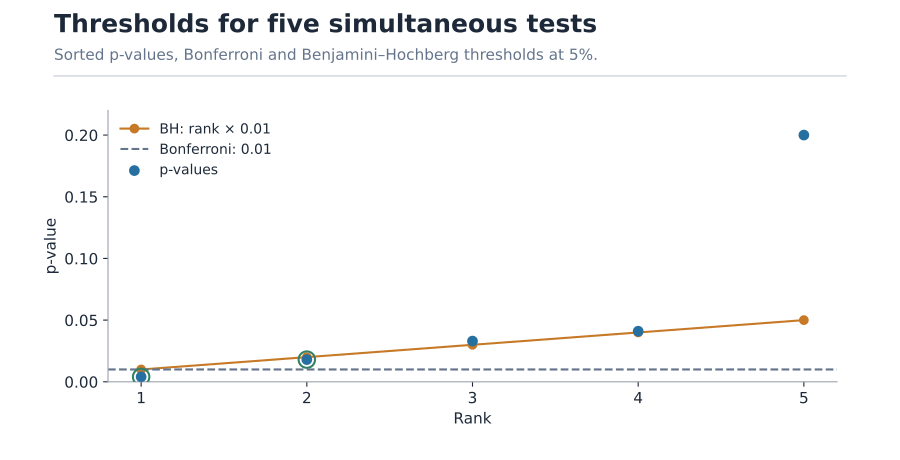

# M6-L7 – Multiple testing and false discoveries {#L7}

**Course area:** M6 – Statistical inference and experimental design

**Level:** Bachelor · Core/Fundamentals

**Prerequisites:** [M4-L6](M4-L6.md); [M6-L4](M6-L4.md) and [M6-L5](M6-L5.md).

**Learning objective:** Distinguish the family-wise error rate from the false discovery rate and apply corrections.

## When many questions are tested at once {#S1}

A sensor database is searched for 20 possible associations, although all null hypotheses are true. If the tests are independent and each rejects with probability 0.05, the probability of at least one false rejection is $1-0.95^{20}\approx0.642$. The expected number of false rejections is 20 times 0.05, or 1. These are different quantities. Tests across different time windows or repeatedly trying different analyses can also constitute a family of tests.

## Protecting the entire family {#S2}

Let $V$ be the number of false rejections and $R$ the number of all rejections. The family-wise error rate (FWER) is $P(V\ge1)$. The Bonferroni rule tests each of $m$ hypotheses at level $\alpha/m$. The union bound gives $P(V\ge1)\le m(\alpha/m)=\alpha$ if the individual tests provide valid p-values; independence is not required. With five tests and a level of 0.05, the threshold is 0.01. Holm's method compares p-values sorted in ascending order successively with $\alpha/(m-i+1)$ and stops at the first exceedance; it rejects at least as many hypotheses as Bonferroni with the same FWER guarantee.

## Benjamini–Hochberg: a proportion rather than an event {#S3}

*Figure: Thresholds for five simultaneous tests.*

The false discovery rate is $E[V/\max(R,1)]$. In the Benjamini–Hochberg procedure (BH), sort the p-values $p_{(1)}\le\cdots\le p_{(m)}$ and find the largest $k$ for which $p_{(k)}\le kq/m$. Reject all hypotheses with ranks up to $k$; if no such rank exists, reject none. FDR control holds under independence or certain positive dependence structures with valid p-values. Under general dependence, a more conservative adjustment such as Benjamini–Yekutieli may be used.

The five p-values 0.004, 0.018, 0.033, 0.041 and 0.20 give thresholds 0.01, 0.02, 0.03, 0.04 and 0.05 at $q=0.05$. The last qualifying rank is 2, so the first two hypotheses are rejected. Bonferroni rejects only the first. The graphic shows the sorted values and both threshold lines. An FDR of 5% does not mean that exactly 5% of the selected results in any single list are false.

## Exercise and solution {#S4}

Three p-values are 0.02, 0.025 and 0.90. Which hypotheses does BH reject at 5%?

Solution: The thresholds are approximately 0.0167, 0.0333 and 0.05. Rank 2 meets the condition, so ranks 1 and 2 are rejected even though rank 1 exceeds its own threshold. The rule is a step-up procedure and must not stop at the first exceedance.

## Sources and further reading {#S5}

- [R stats: Adjust P-values for Multiple Comparisons](https://search.r-project.org/R/refmans/stats/help/p.adjust.html) – **Verification:** pending.
- [SciPy: false_discovery_control (reference)](https://docs.scipy.org/doc/scipy/reference/generated/scipy.stats.false_discovery_control.html) – **Verification:** pending.
