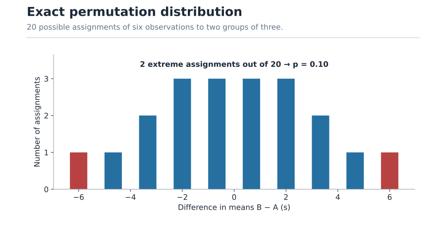

# M6-L8 – Bootstrap and permutation tests {#L8}

**Course area:** M6 – Statistical inference and experimental design

**Level:** Bachelor · Core/Fundamentals

**Prerequisites:** [M4-L8](M4-L8.md); [M6-L2](M6-L2.md) and [M6-L4](M6-L4.md).

**Learning objective:** Distinguish resampling for uncertainty from resampling for a null distribution and apply both reproducibly.

## Samples from the sample {#S1}

Suppose four independently sampled processing times are 2, 4, 6 and 8 s. In the non-parametric bootstrap, four values are repeatedly drawn with replacement from these four observations. In one repetition, some values may occur several times and others may be absent, for example 2, 2, 6, 8 with mean 4.5. The original sample is used as an empirical model. The spread of the repeatedly calculated statistic approximates its standard error; quantiles can form a bootstrap percentile interval. This simple interval can be unreliable for small samples or strongly biased or non-regular statistics.

## Permuting under a null hypothesis {#S2}




*Figure: Exact permutation distribution.*

Two randomly assigned groups yield A=(2,4,6), B=(8,10,12) s. The difference B minus A is 6 s. Under the sharp null hypothesis that no unit is affected by assignment, and with completely random assignment of three units to each group, all $\binom63=20$ group assignments are equally probable. Exactly two give an absolute difference in means of at least 6 s. The exact two-sided p-value is therefore 2/20=0.10. In a general permutation test, the data must be exchangeable under the null hypothesis with respect to the permitted permutations. An arbitrary test of equal means under unequal distributions does not automatically meet this condition. The graphic shows the frequencies of the 20 differences; the two boundary cases belong to the extreme set.

## Computational experiment with Python {#S3}

```python
import numpy as np
from itertools import combinations

rng = np.random.default_rng(42)
x = np.array([2, 4, 6, 8])
boot = rng.choice(x, size=(10000, len(x)), replace=True).mean(axis=1)
print(round(boot.std(ddof=1), 2))

y = np.array([2, 4, 6, 8, 10, 12])
diffs = []
for idx in combinations(range(len(y)), 3):
    mask = np.zeros(len(y), dtype=bool)
    mask[list(idx)] = True
    diffs.append(y[~mask].mean() - y[mask].mean())
print(np.mean(np.abs(diffs) >= 6 - 1e-12))
```

The theoretical bootstrap standard deviation of the mean is $\sqrt{5/4}\approx1.118$ s; the simulation should be close to it. The second output value is 0.1. When permutations are simulated randomly rather than enumerated exhaustively, the Monte Carlo p-value can be calculated using $(b+1)/(B+1)$, where $b$ of the $B$ simulated statistics are at least as extreme as the observed one. The added ones prevent an apparently exact zero in a finite simulation and account for the observed case.

## Limitations, exercise and solution {#S4}

For time series or multiple measurements per device, independent draws of individual observations are usually an incorrect resampling model. Depending on the structure, block or cluster bootstrap and restricted permutations may be appropriate. In a paired study, A and B are measured for each device. How should the paired structure be taken into account?

Solution: In the bootstrap, draw complete device pairs together; in a suitable paired randomisation test, swap the treatment labels within a pair in accordance with the actual assignment design. Unrestricted mixing of all individual measurements destroys the dependencies within pairs.

## Sources and further reading {#S5}

- [OpenIntro: Foundations of inference (tutorial overview)](https://openintrostat.github.io/ims-tutorials/04-foundations/) – **Verification:** pending.
- [OpenIntro Statistics: Chapters 1, 5, 6 and 7 (chapter overview)](https://www.openintro.org/book/os/) – **Verification:** pending.
