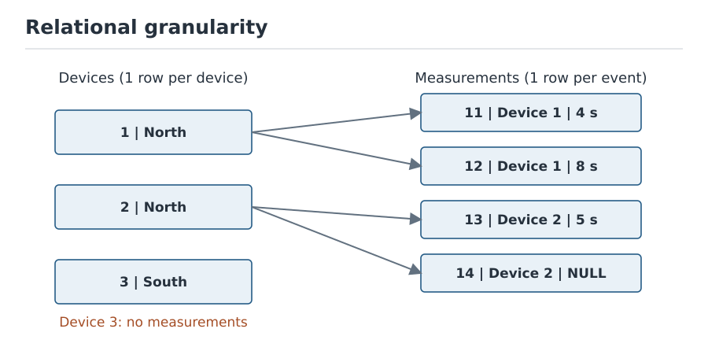

# M7-L1 – Relational modelling and SQL for analytics {#L1}

**Course area:** M7 – Databases and data engineering

**Level:** Bachelor · Core/Fundamentals

**Prerequisites:** [M3-L3](M3-L3.md), [M3-L4](M3-L4.md); tables and keys.

**Learning objective:** Model tables according to their unit of observation and formulate aggregations with the correct join cardinality.

## From event to relation {#S1}

A laboratory records measurements from devices. The device table stores exactly one record per device, and the measurement table exactly one per measurement event. The primary key identifies a row; a foreign key references a valid device key. This avoids repeating the location name for every measurement. A functional dependency `geraet_id → standort` means that the same device key cannot simultaneously denote different locations. If locations change over time, a time-dependent relationship would instead be necessary. Normalisation prevents many update anomalies, but does not guarantee the correct granularity for the domain.

## Joining and grouping {#S2}




*Figure: Relational granularity.*

The synthetic teaching example contains three devices, one of which has no measurements. An inner join would exclude this device; a left join retains it. `COUNT(m.id)` counts only existing measurements, whereas `COUNT(*)` also counts the additional empty row. `AVG` ignores SQL NULLs; an empty measurement group produces NULL, not zero seconds. Grouping is by device, not merely by location, which may occur more than once. The graphic shows how the four measurements are associated with devices.

## Executable SQL example {#S3}

```sql
CREATE TABLE geraet (id INTEGER PRIMARY KEY, standort TEXT NOT NULL);
CREATE TABLE messung (
  id INTEGER PRIMARY KEY,
  geraet_id INTEGER NOT NULL REFERENCES geraet(id),
  dauer_s REAL
);
INSERT INTO geraet VALUES (1,'Nord'),(2,'Nord'),(3,'Sued');
INSERT INTO messung VALUES (11,1,4),(12,1,8),(13,2,5),(14,2,NULL);
SELECT g.id, COUNT(m.id) AS n_messungen,
       COUNT(m.dauer_s) AS n_gueltig, AVG(m.dauer_s) AS mittel_s
FROM geraet g LEFT JOIN messung m ON g.id=m.geraet_id
GROUP BY g.id ORDER BY g.id;
```

The results are `(1,2,2,6.0)`, `(2,2,1,5.0)` and `(3,0,0,NULL)`. When filtering by measurement time or quality in a left join, decide whether these filters belong in the ON condition: a WHERE filter on the right-hand table can remove the added NULL rows. The query uses only common SQL constructs and can be checked locally with SQLite.

## Cardinality, exercise and solution {#S4}

If two additional maintenance events for device 1 are joined to its two measurements using the device ID, four combinations result. Sums of measurement durations are doubled. Exercise: How can the number of maintenance events and the sum of measurement durations be obtained simultaneously for each device? Solution: First aggregate both event tables independently by device ID, then join the two result tables to the device table. Check which metric treats missing values as zero and which treats them as unknown.

## Sources and further reading {#S5}

- [PostgreSQL 18: Joins Between Tables, § 2.6](https://www.postgresql.org/docs/18/tutorial-join.html) – **Verification:** pending.
