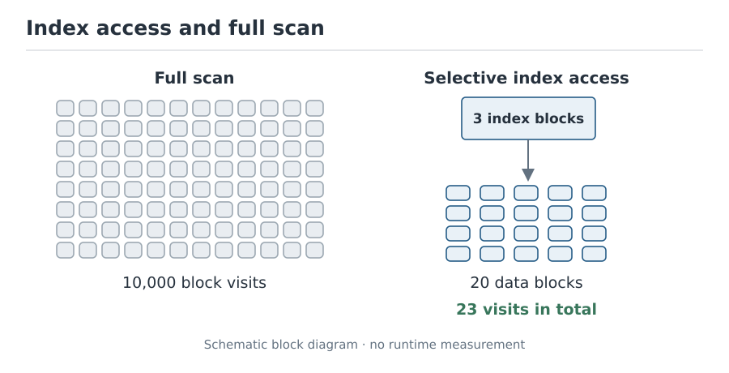

# M7-L2 – Indexing and efficient analytical queries {#L2}

**Course area:** M7 – Databases and data engineering

**Level:** Bachelor · Core/Fundamentals

**Prerequisites:** [M7-L1](M7-L1.md); [M3-L5](M3-L5.md) (complexity).

**Learning objective:** Distinguish selection, data layout and query plans; evaluate the benefit of an index through measurement.

## Logical request and physical execution {#S1}

SQL describes the desired result, not every access step. A database may scan a table sequentially, search an index or combine several access paths. A B-tree keeps keys ordered and supports equality and range searches. The effort required to locate a key grows approximately with the height of the tree; accessing the matching records adds further cost. An index occupies storage space and must also be maintained during writes.

## Selectivity and block accesses {#S2}




*Figure: Index access and full scan.*

A model example: One million measurements are stored in 10,000 blocks of 100 rows each. A query for a rare device ID matches 20 rows. If these are in 20 different blocks and three index blocks are visited, this amounts to 23 block visits compared with 10,000 for a full scan. This is not a runtime prediction: caches, random accesses, index size and the retrieval of additional columns affect costs. With 700,000 matches, a sequential scan may be cheaper. Column-oriented storage also reduces the amount of data that must be read when an analysis uses only a few columns.

## Reading plans and testing hypotheses {#S3}

```sql
CREATE INDEX idx_geraet ON messung(geraet_id);
SELECT AVG(dauer_s) FROM messung WHERE geraet_id=1;
```

In PostgreSQL, inspect the plan for the SELECT query with `EXPLAIN` and its actual execution with `EXPLAIN (ANALYZE, BUFFERS)`. Estimated and measured row counts show where the optimiser misjudges the data profile. `ANALYZE` as an EXPLAIN option actually executes the statement; this is particularly important for statements that modify data. With a composite index `(geraet_id, zeit)`, queries for a device within a time range are natural candidates; the suitability of other filters depends, among other things, on the DBMS and the plan.

## Exercise and solution {#S4}

A query reads all measurements from one day, and the table is physically partitioned by day. Is an index on the device sufficient? Solution: Not necessarily. Partition pruning can exclude irrelevant days if the predicate matches the partitioning scheme. An additional device index helps only if the query is sufficiently selective within the remaining data. Compare plans, blocks read and runtimes with and without an index using realistic data volumes; small teaching tables do not provide a production benchmark.

## Sources and further reading {#S5}

- [PostgreSQL 18: Introduction to Indexes, § 11.1](https://www.postgresql.org/docs/18/indexes-intro.html) – **Verification:** pending.
- [PostgreSQL 18: Using EXPLAIN, § 14.1](https://www.postgresql.org/docs/18/using-explain.html) – **Verification:** pending.
