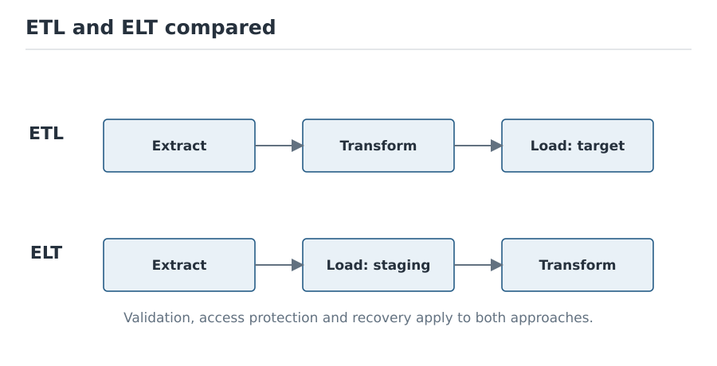

# M7-L3 – Data integration, ETL and ELT {#L3}

**Course area:** M7 – Databases and data engineering

**Level:** Bachelor · Core/Fundamentals

**Prerequisites:** [M3-L4](M3-L4.md) to [M3-L8](M3-L8.md); [M5-L1](M5-L1.md); [M7-L1](M7-L1.md).

**Learning objective:** Design repeatable data integration with domain-specific transformation and error isolation.

## Integration rather than simply copying files {#S1}

Two measurement systems report durations in seconds and milliseconds respectively; one uses local time, the other UTC. Before combining them, the units, time reference, keys, missing-value encodings and provenance must be known. A technical data type of REAL does not establish a common unit. The target model includes `event_id`, `zeit_utc`, `dauer_s`, `quelle` and the processing revision. Event IDs must be unique across sources, for example through a composite source key.

## Processing order {#S2}




*Figure: ETL and ELT compared.*

ETL extracts data, transforms it in an upstream processing step and loads the result into the target dataset. ELT first loads the extracted data into suitable target or staging storage, then uses the computing capacity there. In practice, hybrid approaches exist. With ELT, raw data must not automatically become visible to all analysts. With ETL, the reproducibility of the transformation must be ensured, for example through permitted input snapshots and code versions. Erroneous rows are isolated with a reason rather than silently deleted.

## Repeatable teaching example {#S3}

```python
raw = [('A', '10', 2500, 'ms'), ('B', '3', 4, 's'),
       ('A', '11', -1, 'ms'), ('A', '10', 2500, 'ms')]
accepted, rejected = {}, []
for source, event_id, value, unit in raw:
    key = (source, event_id)
    if unit not in {'s', 'ms'} or value < 0:
        rejected.append((key, 'ungueltige Dauer oder Einheit'))
        continue
    seconds = value / 1000 if unit == 'ms' else value
    if key in accepted and accepted[key] != seconds:
        raise ValueError('widerspruechliche Ereignis-ID')
    accepted[key] = seconds
assert accepted == {('A','10'): 2.5, ('B','3'): 4}
assert len(rejected) == 1
```

The duplicate row does not change the final dataset. The example deliberately omits timestamps and persistent transactions: a real pipeline must manage version selection, the restart position and atomic ingestion between the source and the target store. An upsert with a stable ID prevents duplicate entries only if all associated changes are handled consistently.

## Exercise and solution {#S4}

After a network failure, a batch that has already been transferred is replayed. How can duplicate revenue entries be prevented? Solution: Assign a stable batch or event ID, store the ingestion state atomically with the target change, and acknowledge the source only after successful persistence. In the event of partial failures, the restart must apply the same domain rules. Simply adding the amount again to the existing total is not idempotent.

## Sources and further reading {#S5}

- [Delta Kernel: Idempotent writes](https://docs.delta.io/kernel/rust/writing/idempotent_writes) – **Verification:** pending.
- [Microsoft Learn: Dimensional modelling, star schema design](https://learn.microsoft.com/de-de/fabric/data-warehouse/dimensional-modeling-overview) – **Verification:** pending.
