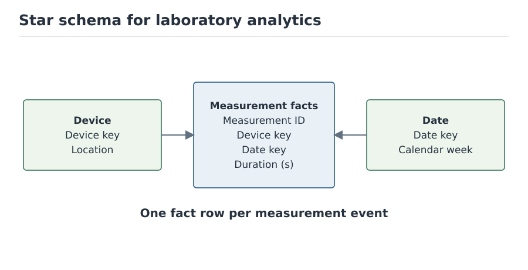

# M7-L4 – Data warehouses, lakes and lakehouses {#L4}

**Course area:** M7 – Databases and data engineering

**Level:** Bachelor · Core/Fundamentals

**Prerequisites:** [M7-L1](M7-L1.md) to [M7-L3](M7-L3.md).

**Learning objective:** Compare storage architectures in terms of data form, transactions, access and analytical objectives.

## Three architectural principles {#S1}

A data warehouse provides integrated data structured for analysis, often with relational semantics and defined metrics. A data lake stores heterogeneous data, such as audio files, logs and column-oriented files, in object or file storage. A lakehouse adds a managed table layer to a lake, for example consistent table snapshots, schema rules and transaction rules. These terms denote architectural principles, not mutually exclusive product classes. A collection of files alone does not provide a reliable shared table view.

## Facts and dimensions {#S2}

*Figure: Star schema for laboratory analytics.*

A star schema for laboratory operations contains one row per measurement event in the fact table, with `geraet_key`, `datum_key` and `dauer_s`. Device and date are separately described dimensions. Fact granularity must be established before the metrics are selected. A device may historically have had a different location; a versioned dimension with validity intervals allows historical measurements to be associated with the location that was valid at the time. The key then denotes the dimension version, not merely the physical device.

## Metrics from subsets {#S3}

A location provides 2 valid measurements with a mean of 5 s on Monday and 8 with a mean of 9 s on Tuesday. The weekly mean across all ten measurements is

$$\bar x=\frac{2\cdot5+8\cdot9}{2+8}=8.2\,\mathrm{s}.$$

The unweighted mean of the daily means (7 s) answers a different question. For aggregated measurements, therefore, store the sum and count if subsequent roll-ups are required. Transaction logs in a table format can version data and metadata changes together; the isolation and compatibility guarantees depend on the specific format, connector and operating environment.

## Exercise and solution {#S4}

A team trains models on video recordings and also analyses daily device counts. Must it copy all videos into relational tables? Solution: No. Videos can reside in a controlled object store, while metadata, access information and analyses are organised in a warehouse or managed lakehouse tables. Reproducible models require unambiguous data versions, not merely the latest file path.

## Sources and further reading {#S5}

- [Microsoft Learn: Dimensional modelling, star schema design](https://learn.microsoft.com/de-de/fabric/data-warehouse/dimensional-modeling-overview) – **Verification:** pending.
- [Delta Lake: Documentation overview](https://docs.delta.io/) – **Verification:** pending.
