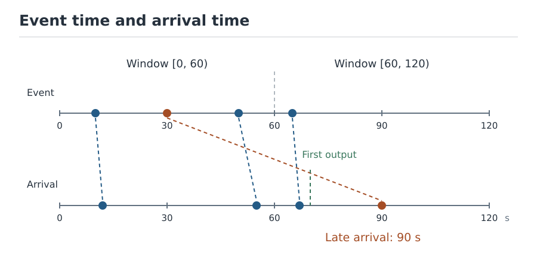

# M7-L5 – Batch and stream processing {#L5}

**Course area:** M7 – Databases and data engineering

**Level:** Bachelor · Core/Fundamentals

**Prerequisites:** [M4-L1](M4-L1.md); [M7-L3](M7-L3.md).

**Learning objective:** Combine event time, processing time, windows, watermarks and corrections with clear justification.

## Bounded and ongoing inputs {#S1}

A batch processes a bounded input dataset, such as the complete file for one day. A stream consists of a sequence of events that is generally not bounded in advance. A system may process the stream in small batches or pass on events individually; the domain semantics are not determined solely by the technical processing cadence. Continuous processing requires state management, recovery and a rule for when results are emitted.

## Two clocks and a window {#S2}

*Figure: Event time and arrival time.*

We count measurements in the time windows [0,60) and [60,120) s from the start of observation, using event time. Let the pairs (event time, arrival time) be (10,12), (50,55), (65,67) and (30,90). An initial result for the first window is emitted at arrival time 70, after the watermark has passed the window boundary: two events. Despite arriving at 90, the fourth event belongs to the first minute. An allowed lateness that still includes this event permits a correction to three; the second window contains one so far. Watermarks are progress estimates or system-specific guarantees, not universally exact statements about remaining events.

## Emission, replay and correction {#S3}

Triggers determine when provisional and subsequent results are emitted. A dashboard can maintain traceable versions using `(fenster_start, revision)` or replace an existing window row. If, instead, first two and then three are processed as additive new contributions, the incorrect value five results. Deduplication by event ID and persistent checkpoints limit the effects of replay. End-to-end exactly-once processing requires compatible source, state and sink semantics; the designation of a streaming engine alone is insufficient. For events arriving beyond the permitted lateness, an explicit strategy for discarding, reprocessing or handling errors is necessary.

## Exercise and solution {#S4}

The window size is 60 s and the event timestamp is exactly 60 s. Which window contains the event? Solution: [60,120), because the right-hand boundary is excluded. If it arrives only after the allowed lateness has expired, the documented late-data rule determines its processing, not the arithmetic rule for window assignment.

## Sources and further reading {#S5}

- [Apache Beam: Basics of the Beam model, Windowing / Watermarks / Trigger](https://beam.apache.org/documentation/basics/) – **Verification:** pending.
- [Delta Kernel: Idempotent writes](https://docs.delta.io/kernel/rust/writing/idempotent_writes) – **Verification:** pending.
