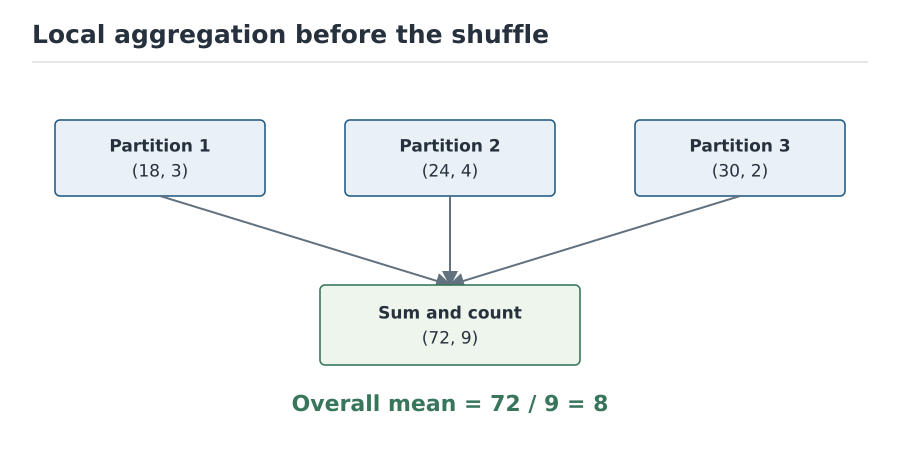

# M7-L6 – Partitioning, distributed processing and scaling {#L6}

**Course area:** M7 – Databases and data engineering

**Level:** Bachelor · Core/Fundamentals

**Prerequisites:** [M3-L5](M3-L5.md), [M3-L8](M3-L8.md); [M7-L2](M7-L2.md) and [M7-L5](M7-L5.md).

**Learning objective:** Analyse distributed aggregation, communication costs and data imbalance.

## Compute locally, exchange selectively {#S1}

Partitions divide a dataset into units that can be processed separately. Range partitioning by date can facilitate selective time queries; hash partitioning by key attempts to distribute keys across several partitions. In a grouped analysis, contributions for a given key must be brought together. This exchange of data between computing nodes is called a shuffle and can place demands on the network, memory and disks. Storage partitions and processing partitions are not necessarily identical.

## Reduction before the shuffle {#S2}

*Figure: Local aggregation before the shuffle.*

Three processing units provide the following (sum, count) pairs for the same key: (18,3), (24,4), (30,2). Instead of transmitting nine individual values, three pairs can be transmitted and added component-wise. The overall result is (72,9), with a mean of 8. The three local means of 6, 6 and 15 would give an unweighted mean of 9 and thus an incorrect overall estimate. Associative and commutative combinations are particularly suitable for local pre-aggregation; floating-point rounding may cause small numerical differences when the order changes.

## Limits of speed-up {#S3}

For an idealised parallel fraction $p$ and $k$ equally fast computing units, Amdahl's model is

$$S(k)=\frac{1}{(1-p)+p/k}.$$

With $p=0.9$ and $k=8$, the result is $S\approx4.71$, not eight. Communication and coordination costs are omitted from the model. In addition, skew produces unequal partition sizes: with four nodes working simultaneously at the same processing rate and shares of 70%, 10%, 10%, 10%, the largest partition determines the duration of this idealised stage. The speed-up relative to one node would be at most $1/0.7\approx1.43$, provided that no other costs arise.

## Exercise and solution {#S4}

In a join, the dimension contains only 1,000 rows, while the event table contains several million. What alternative to exchanging both tables is available? Solution: The small dimension can be replicated to the computing nodes (broadcast join), provided it fits into available memory and the plan supports the desired join semantics. Check actual sizes, skew and network costs before forcing replication.

## Sources and further reading {#S5}

- [Apache Spark: SQL Performance Tuning, join strategies / partitioning / skew](https://spark.apache.org/docs/latest/sql-performance-tuning.html) – **Verification:** pending.
