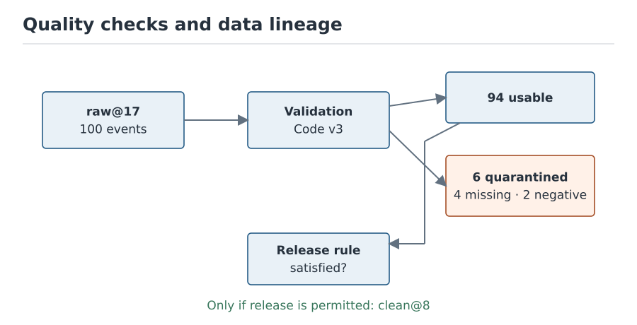

# M7-L7 – Data contracts, lineage and quality assurance {#L7}

**Course area:** M7 – Databases and data engineering

**Level:** Bachelor · Core/Fundamentals

**Prerequisites:** [M3-L6](M3-L6.md), [M3-L7](M3-L7.md), [M5-L1](M5-L1.md); [M7-L3](M7-L3.md).

**Learning objective:** Define data quality as a verifiable contract and reconstruct results along their lineage.

## Contracts are domain agreements {#S1}

A data contract defines what providers and users of a dataset may expect from one another. This includes the schema, units, keys, time reference, null rules, permissible values, freshness limits and responsibilities. An additional optional column may be compatible; switching from seconds to milliseconds without changing the column name is, by contrast, a semantic break, even if the type and test values look the same. Changes require versioning rules and clear migration deadlines.

## From contract to measurable test objective {#S2}

A daily batch contains 100 events. Of these, 96 have a non-missing duration, and two of those 96 are negative. Completeness relative to all events: 96/100 = 96%. Value validity relative to available values: 94/96 ≈ 97.92%. The proportion of usable events relative to all events is 94/100 = 94%. Different denominators must remain visible; otherwise apparent quality is not comparable. A contract may require at least 98% completeness and no negative durations, for example. Both rules would be violated here. The affected events can be isolated and a release step blocked.

## Lineage and run logs {#S3}

*Figure: Quality checks and data lineage.*

Data lineage connects input datasets, processing steps and outputs. A run may document the snapshot `raw@17`, transformation code `v3`, an input count of 100, a quarantine count of 6 and the published snapshot `clean@8`, for example. In the graphic, the published state is only a hypothetical result if the release rule permits partial publication; otherwise the run stops before publication. OpenLineage is an example of a standardised event model comprising datasets, jobs and specific runs. Lineage is no guarantee that the computational logic is correct. Tests of schemas, keys, domain invariants, distribution shifts and regressions are also useful.

## Exercise and solution {#S4}

A model's accuracy falls from 90% to 70% after a data import. Which lineage information helps with diagnosis? Solution: The input snapshot, time window, feature/transformation version, quality reports, training state and evaluation data version allow controlled comparisons. An observed distribution shift is initially a warning signal, not yet proof of a faulty pipeline.

## Sources and further reading {#S5}

- [OpenLineage: Standard API for lineage events](https://openlineage.io/) – **Verification:** pending.
