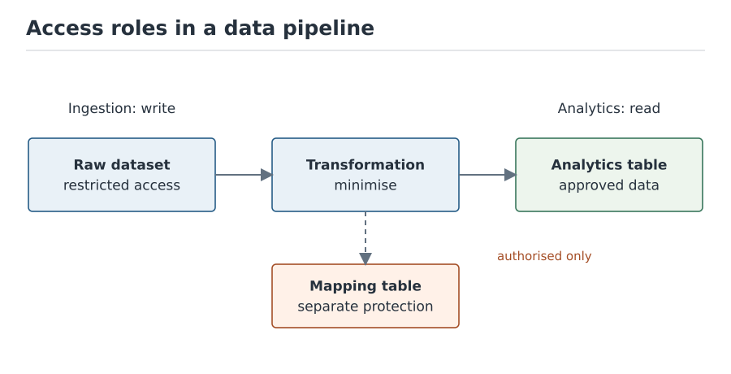

# M7-L8 – Data protection and access control in data pipelines {#L8}

**Course area:** M7 – Databases and data engineering

**Level:** Bachelor · Core/Fundamentals

**Prerequisites:** [M1-L5](M1-L5.md), [M7-L3](M7-L3.md) and [M7-L7](M7-L7.md).

**Learning objective:** Translate data protection principles into specific technical safeguards and verifiable access separation.

## Protection begins before storage {#S1}

For personal data, the purpose, legal basis and necessary attributes must be clarified. Article 5 of the General Data Protection Regulation (GDPR) requires, among other things, purpose limitation, data minimisation, storage limitation and protection of integrity and confidentiality; Articles 25 and 32 concern data protection by design and security of processing. A teaching example is not legal advice: the applicable legal basis and retention period depend on the actual processing activity. An app that only analyses daily device counts may not need a user's email address for that purpose.

## Separating roles, keys and data {#S2}

*Figure: Access roles in a data pipeline.*

One possible pipeline holds raw personal data in a restricted area. A transformation service produces pseudonymised events for analysis and removes unnecessary fields. The mapping table linking pseudonyms to individuals must be protected separately, for example through separate permissions and keys. Pseudonymised data may still be personal data; even aggregated data may allow inferences in small groups or when linked with additional knowledge. Encryption in transit and at rest reduces individual risks, but replaces neither access control nor lawful processing.

## An example permissions matrix {#S3}

The ingestion service may write new raw events, but not read arbitrary raw data; the transformation service may read the required input dataset and write the minimised table; the analytics role receives only read permissions for approved tables and no access to the mapping. Administrator rights are separated and logged. Also define deletion and retention rules for replicas, backups, caches and logs. A successful access test with an authorised role is not sufficient: negative tests must demonstrate that unauthorised accesses fail.

## Exercise and solution {#S4}

An analyst receives only a table of hashed email addresses. Is it anonymous? Solution: Not automatically. Email addresses can be reconstructed using candidate lists or linked to other datasets; a hash without additional safeguards is particularly vulnerable to this. Identifiability must be assessed in context. Avoid unnecessary identifiers and check purpose, access, key management and deletion. Anonymisation is a stronger requirement than simply replacing names.

## Sources and further reading {#S5}

- [Regulation (EU) 2016/679, in particular Arts. 4, 5, 6, 25, 32](https://eur-lex.europa.eu/eli/reg/2016/679/oj/eng) – **Verification:** pending.
