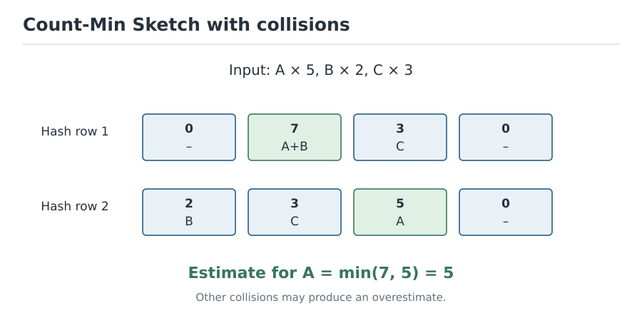

# M7-L9 – Streaming algorithms: sketches, reservoirs and approximate counting {#L9}

**Course area:** M7 – Databases and data engineering

**Level:** Bachelor · Elective specialisation

**Prerequisites:** [M4-L2](M4-L2.md), [M4-L7](M4-L7.md); [M7-L5](M7-L5.md) and [M7-L6](M7-L6.md).

**Learning objective:** Explain reservoir sampling, Count-Min Sketch and distinct counting as different memory trade-offs.

## A sample without a known total length {#S1}

A stream contains $N$ elements, with the total length unknown at the start. Reservoir sampling (Algorithm R) stores the first $k$ elements. At element number $i>k$, an integer from 1 to $i$ is drawn uniformly; if it is in the range 1 to $k$, the element replaces the corresponding reservoir position. For $N\ge k$, each element has a final selection probability of $k/N$. An already stored element is retained at the next step with probability $1-1/i$: $k/(i-1)\cdot(i-1)/i=k/i$. The new element is included with probability $k/i$. This establishes the individual inclusion probability inductively. For a uniform sample of k distinct positions, the stronger induction also gives equal probabilities for all subsets of size k.

## Frequencies with Count-Min Sketch {#S2}




*Figure: Count-Min Sketch with collisions.*

A Count-Min Sketch consists of $d$ rows of counters with $w$ cells each and suitable independent hash functions. For every non-negative update of key $x$, the counter at its hash position is incremented in each row. The estimate is the minimum of the associated counters. Without deletions, or with non-negative updates, and without counter overflow, $\hat f_x\ge f_x$ holds because collisions only add further mass. For $w=\lceil e/\varepsilon\rceil$ and $d=\lceil\ln(1/\delta)\rceil$, with suitable independent hash functions the additive bound $\hat f_x\le f_x+\varepsilon N$ holds with probability at least $1-\delta$ for a fixed chosen key; here $N$ denotes the total insertion mass. With $\varepsilon=0.01$, $\delta=0.05$, this gives 272 columns and 3 rows, or 816 counters. To justify this: For one row, the expected collision mass under pairwise independent uniform hashing is at most $N/w$. Markov's inequality bounds the probability of exceeding $\varepsilon N$ by $1/(w\varepsilon)\le1/e$. All $d$ independent rows therefore fail simultaneously with probability at most $e^{-d}\le\delta$. The minimum may be correct despite collisions: the graphic shows two counters of 7 and 5 for A, with a true frequency of 5.

## A different task: counting distinct keys {#S3}

The number of distinct event IDs differs from the frequency of a particular key. HyperLogLog uses hash values and registers that store information about rare bit patterns; cardinality is estimated from many registers. For large cardinalities in the typical asymptotic regime, the relative standard error of classical HLL is approximately $1.04/\sqrt{m}$ with $m$ registers; with 4,096 registers, this is about 1.625%. This is not a hard error bound; hash quality, correction methods and the cardinality range affect accuracy. Reservoirs, by contrast, are actual samples of events that can be used, for example, to estimate measurement distributions.

## Computational experiment and exercise {#S4}

```python
import random
rng = random.Random(42)
def reservoir(stream, k):
    sample = []
    for i, value in enumerate(stream, 1):
        if i <= k:
            sample.append(value)
        else:
            j = rng.randrange(i)
            if j < k:
                sample[j] = value
    return sample
hits = sum(0 in reservoir(range(20), 4) for _ in range(10000))
print(hits / 10000)
```

The expected value is 0.2; random deviation is normal. Exercise: Which structure would you choose for the number of distinct user pseudonyms in a very large number of events? Solution: A cardinality estimator (e.g. HLL) if estimation error is tolerable; a Count-Min Sketch instead answers frequency questions, and a reservoir alone does not count distinct users reliably. Data protection and permitted storage also apply to sketch states.

## Sources and further reading {#S5}

- [Cormode and Muthukrishnan (2005): An improved data stream summary: the count-min sketch and its applications, Journal of Algorithms 55(1), 58–75](https://www.cs.ox.ac.uk/people/graham.cormode/pubs/html/CormodeMuthukrishnan04CMJalg.html) – **Verification:** pending.
- [Vitter (1985): Random sampling with a reservoir, ACM TOMS 11(1), 37–57](https://doi.org/10.1145/3147.3165) – **Verification:** pending.
- [Flajolet, Fusy, Gandouet, Meunier (2007): HyperLogLog: the analysis of a near-optimal cardinality estimation algorithm](https://dmtcs.episciences.org/en/articles/3545) – **Verification:** pending.
