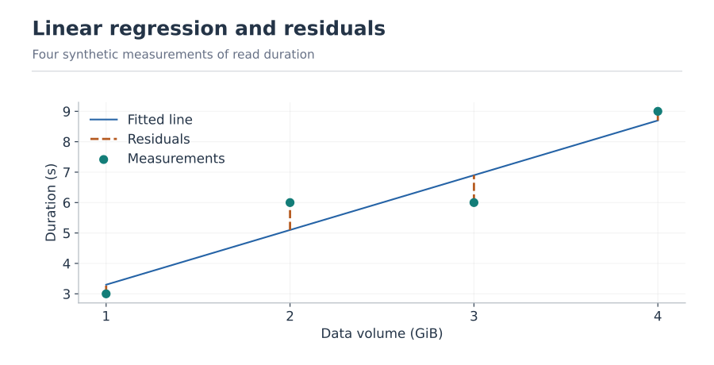

# M8-L1 – Simple linear regression and least squares {#L1}

**Course area:** M8 – Regression and statistical models

**Level:** Bachelor · Core/Fundamentals

**Prerequisites:** [M2-L1](M2-L1.md), [M2-L3](M2-L3.md), [M2-L5](M2-L5.md), [M4-L4](M4-L4.md) and [M6-L2](M6-L2.md).

**Learning objective:** Derive a straight line from measurement data, calculate residuals and interpret goodness of fit.

## Response variable and regression line {#S1}

A testing laboratory investigates how long it takes to read a memory module. The amount of data $x$ in GiB is known; the duration $Y$ in seconds varies even for the same data volume. We model the conditional mean as $E(Y\mid x)=\beta_0+\beta_1x$. The observation satisfies $y_i=\beta_0+\beta_1x_i+\varepsilon_i$. The error $\varepsilon_i$ is unobservable, whereas the residual $e_i=y_i-\hat y_i$ can be calculated. The intercept is measured in seconds and the slope in seconds per GiB. The intercept can only be interpreted as a fixed start-up time if zero GiB is meaningful in the context and the model holds there.

## Determining the line from the data {#S2}




*Figure: Linear regression and residuals.*

Ordinary least squares (OLS) minimises $Q(b_0,b_1)=\sum_i(y_i-b_0-b_1x_i)^2$. Setting both partial derivatives to zero yields $\sum_i e_i=0$ and $\sum_i x_ie_i=0$. The first equation gives $b_0=\bar y-b_1\bar x$. Substituting this into the second gives, for non-constant $x_i$:

$$b_1=\frac{\sum_i(x_i-\bar x)(y_i-\bar y)}{\sum_i(x_i-\bar x)^2},\qquad b_0=\bar y-b_1\bar x.$$

For our own teaching data $(1,3),(2,6),(3,6),(4,9)$, $\bar x=2.5$, $\bar y=6$, the centred sum of products is 9 and the sum of squares is 5. Thus $b_1=1.8$ and $b_0=1.5$. The four predictions are 3.3, 5.1, 6.9 and 8.7. The graphic shows the vertical residuals. The sum of squared errors is $0.09+0.81+0.81+0.09=1.8\,\mathrm{s}^2$. Squaring gives a large error particularly high weight.

## Fit and implementation {#S3}

With an intercept and a non-constant response, $R^2=1-\mathrm{SSE}/\mathrm{SST}$, where $\mathrm{SST}=\sum_i(y_i-\bar y)^2$. Here SST = 18, so $R^2=0.9$. This measure describes fit on the training data; it can become negative on test data. It measures neither causality nor the quality of individual predictions. The estimate of error variance is $s^2=\mathrm{SSE}/(n-2)$, provided the model is correct with independent, homoscedastic errors.

```python
import numpy as np
x = np.array([1., 2., 3., 4.])
y = np.array([3., 6., 6., 9.])
X = np.column_stack([np.ones(len(x)), x])
b, *_ = np.linalg.lstsq(X, y, rcond=None)
e = y - X @ b
assert np.allclose(b, [1.5, 1.8])
assert np.isclose(e @ e, 1.8)
```

The numerical least-squares solution avoids explicitly inverting a matrix. Before applying the model to new data, check that the range of values is valid and the process is stable.

## Exercise and solution {#S4}

Calculate the estimated read duration for 2.5 GiB and the residual of an observed duration of 7 s at that point. Solution: $1.5+1.8\cdot2.5=6$ s, $e=1$ s. The additional observation was not used in the original estimation.

## Sources and further reading {#S5}

- [NIST/SEMATECH e-Handbook: Linear Least Squares Regression](https://www.itl.nist.gov/div898/handbook/pmd/section1/pmd141.htm) – **Verification:** pending.
- [NIST/SEMATECH e-Handbook: Average response](https://www.itl.nist.gov/div898/handbook/pmd/section5/pmd511.htm) – **Verification:** pending.
