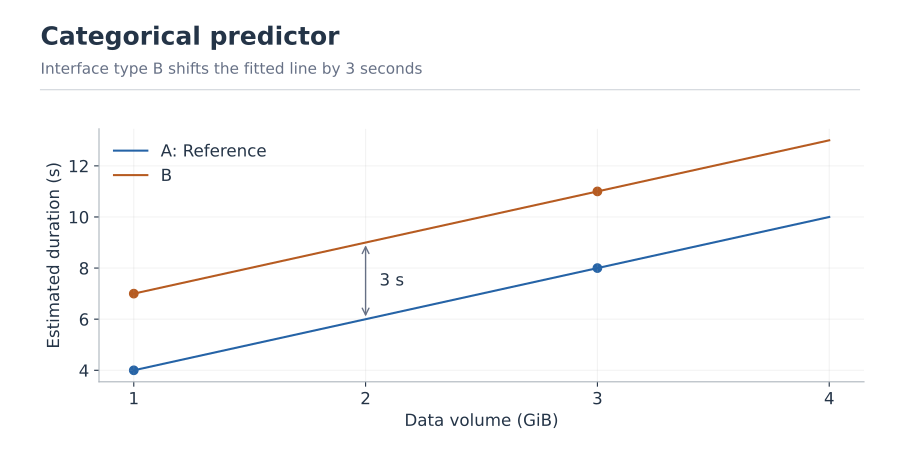

# M8-L2 – Multiple regression and categorical predictors {#L2}

**Course area:** M8 – Regression and statistical models

**Level:** Bachelor · Core/Fundamentals

**Prerequisites:** [M8-L1](M8-L1.md), [M2-L1](M2-L1.md), [M2-L3](M2-L3.md) and [M3-L3](M3-L3.md).

**Learning objective:** Construct a design matrix with numerical and categorical features and interpret conditional coefficients.

## From one measurement variable to several {#S1}

Read duration also depends on the interface. With several predictors, $E(Y\mid x_1,\ldots,x_p)=\beta_0+\sum_{j=1}^p\beta_jx_j$. A coefficient describes the change in the modelled mean for a one-unit increase in the corresponding feature, holding the remaining features fixed. This is a conditional statistical statement, not an experimental effect.

For $n$ observations, the design matrix $X\in\mathbb R^{n\times(p+1)}$ combines the inputs. Its first column contains ones. OLS minimises $\|y-Xb\|_2^2$; the normal equation is $X^TXb=X^Ty$. With full column rank, the solution $(X^TX)^{-1}X^Ty$ is unique. For numerical computations, QR decomposition or SVD is preferable to forming the inverse matrix. If the matrix is rank deficient, coefficients are not unique without an additional convention.

## Encoding categories correctly {#S2}




*Figure: Categorical predictor.*

An interface has two types, A and B. The indicator $d$ is 1 for B and 0 for A. In our synthetic teaching model, $\hat y=2+2x+3d$ (duration in s, data volume in GiB). A is the reference. At 2 GiB, the estimated duration is 6 s for A and 9 s for B. The slope is the same for both types; the graphic shows the parallel lines. For three types with A as the reference, two indicators are needed, for example $d_B,d_C$. All three indicators together with a column of ones would be linearly dependent, since their sum in each row is one. Numerical codes 0, 1, 2, by contrast, would assume an unverified ordering and equally spaced effects.

| Data volume (GiB) | Type | One | x | d | Duration (s) |
|---:|---|---:|---:|---:|---:|
| 1 | A | 1 | 1 | 0 | 4 |
| 3 | A | 1 | 3 | 0 | 8 |
| 1 | B | 1 | 1 | 1 | 7 |
| 3 | B | 1 | 3 | 1 | 11 |

The table was deliberately constructed without noise to illustrate the encoding in isolation. Real measurements require replicates and an uncertainty analysis.

## Dependent features {#S3}

```python
import numpy as np
X = np.array([[1,1,0], [1,3,0], [1,1,1], [1,3,1]])
y = np.array([4,8,7,11])
b, _, rank, _ = np.linalg.lstsq(X,y,rcond=None)
assert rank == 3 and np.allclose(b,[2,2,3])
```

If two numerical features are nearly linearly dependent, individual coefficients become unstable, even if predictions within the observed range still work. For a numerical feature, $\mathrm{VIF}_j=1/(1-R_j^2)$ may help: $R_j^2$ comes from an auxiliary regression of this feature on the other features, including an intercept. A value approaching infinity indicates almost perfect linear predictability; rigid thresholds do not replace investigation. New categories need a predefined treatment rather than silently being assigned the reference code.

## Exercise and solution {#S4}

Extend the teaching model to include C, which is 1 s faster than A for the same data volume. Solution: $\hat y=2+2x+3d_B-d_C$. At 4 GiB and type C, the estimate is 9 s. The difference between B and C at the same data volume is 4 s, not 3 s.

## Sources and further reading {#S5}

- [NIST/SEMATECH e-Handbook: Linear Least Squares Regression](https://www.itl.nist.gov/div898/handbook/pmd/section1/pmd141.htm) – **Verification:** pending.
- [Penn State STAT 501: Categorical Predictors](https://online.stat.psu.edu/stat501/Lesson08) – **Verification:** pending.
- [Penn State STAT 501: Multicollinearity & Other Regression Pitfalls](https://online.stat.psu.edu/stat501/Lesson12) – **Verification:** pending.
