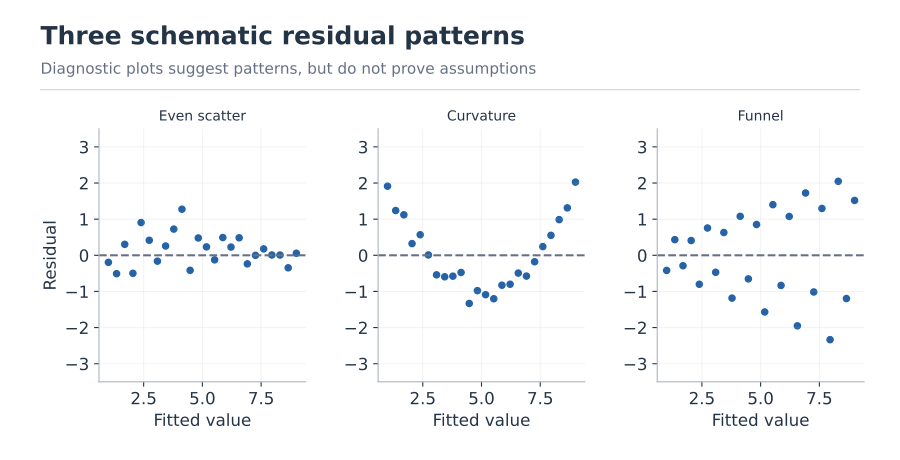

# M8-L3 – Diagnostics, residuals and model assumptions {#L3}

**Course area:** M8 – Regression and statistical models

**Level:** Bachelor · Core/Fundamentals

**Prerequisites:** [M8-L1](M8-L1.md), [M8-L2](M8-L2.md), [M5-L3](M5-L3.md) and [M6-L4](M6-L4.md).

**Learning objective:** Distinguish residual patterns and justify appropriate responses to violations of assumptions.

## Which assumptions are needed for which purposes? {#S1}

OLS regression lines can be calculated even without an assumption of normality. Unbiased coefficients for a given full-rank $X$ require, in particular, $E(\varepsilon\mid X)=0$. The classical variance formula $\operatorname{Var}(b\mid X)=\sigma^2(X^TX)^{-1}$ additionally requires $\operatorname{Var}(\varepsilon\mid X)=\sigma^2I$: constant error variance and no error correlation. Conditionally normally distributed errors allow exact classical t and F procedures for small samples under these assumptions. None of these properties requires normally distributed predictors. The residuals are dependent on one another as a result of fitting, even when the model errors are independent.

## Recognising error patterns {#S2}

*Figure: Three schematic residual patterns.*

Inspect residuals against fitted values, against individual predictors and in measurement order. Our own graphic shows three schematic point patterns: roughly even scatter, systematic curvature and a funnel. Curvature suggests an inappropriate mean function; the funnel suggests potentially changing variance. A temporal pattern may arise from device heating or serial dependence. A quantile–quantile plot compares empirical residual quantiles with theoretical quantiles; unusual behaviour in the extremes may indicate heavy distribution tails. An unremarkable plot does not prove an assumption.

For the teaching data from [M8-L1](M8-L1.md), $s=\sqrt{1.8/2}\approx0.949$ s. For the first observation in the simple regression, the leverage is

$$h_{11}=\frac1n+\frac{(x_1-\bar x)^2}{\sum_i(x_i-\bar x)^2}=0.25+\frac{2.25}{5}=0.7.$$

The diagonal of the projection matrix $H=X(X^TX)^{-1}X^T$ measures how strongly an observation influences its own fitted value. An internally studentised residual is $r_i=e_i/(s\sqrt{1-h_{ii}})$; here $r_1\approx-0.577$. High leverage is not a measurement error. Cook's distance combines residual and leverage: $D_i=e_i^2h_{ii}/[q s^2(1-h_{ii})^2]$ with $q$ estimated coefficients including the intercept. When $h_{ii}=1$, this formula is not applicable.

## Responding to findings {#S3}

When variance is non-constant, heteroscedasticity-robust standard errors can improve inference provided the mean function is correct and observations are sufficiently independent. Weighted least squares uses appropriate inverse-variance weights if their structure is justified. When observations are dependent, methods such as cluster-robust procedures or time-series models are needed. In the presence of curvature, a new model function justified by domain knowledge may help. Erroneous data are corrected according to documented rules; valid extreme values are not deleted just because they are inconvenient. Results with and without influential cases can be reported as a sensitivity analysis.

## Exercise and solution {#S4}

In a sample, residual dispersion increases with estimated duration, while the mean of the residuals is approximately zero everywhere. What is affected? Solution: initially the assumption of constant error variance, not necessarily the mean function. Examine dependence and the measurement process, consider robust standard errors, and check prediction intervals separately, because robust coefficient standard errors do not automatically correct the variability of future individual measurements.

## Sources and further reading {#S5}

- [NIST Dataplot: Regression Diagnostics](https://www.itl.nist.gov/div898/software/dataplot/refman1/auxillar/regrdiag.htm) – **Verification:** pending.
- [NIST/SEMATECH e-Handbook: Non-constant variation](https://www.itl.nist.gov/div898/handbook/pmd/section4/pmd442.htm) – **Verification:** pending.
