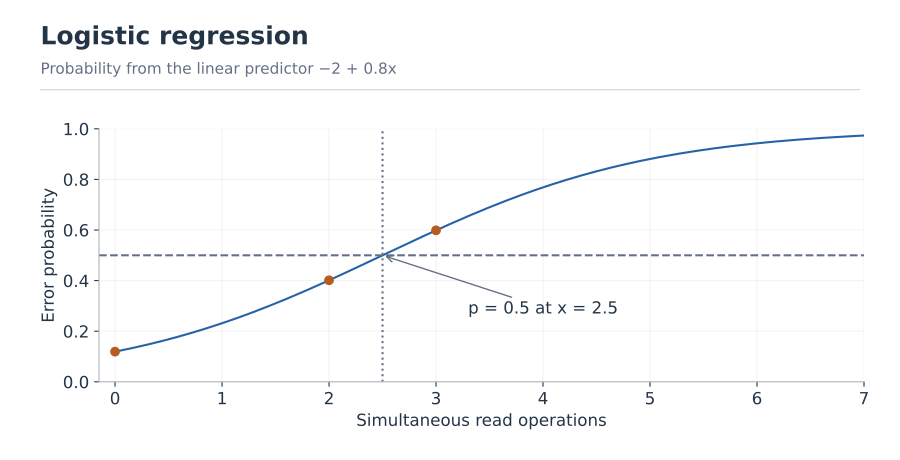

# M8-L4 – Generalised linear models and logistic regression {#L4}

**Course area:** M8 – Regression and statistical models

**Level:** Bachelor · Core/Fundamentals

**Prerequisites:** [M8-L2](M8-L2.md), [M4-L1](M4-L1.md), [M4-L2](M4-L2.md) and [M6-L3](M6-L3.md).

**Learning objective:** Model a binary response using the logit link and distinguish odds, probabilities and coefficients.

## Choosing the distribution and link {#S1}

A memory read operation ends either with an error message ($Y=1$) or without one ($Y=0$). Ordinary linear regression can yield invalid probabilities below zero or above one. A generalised linear model (GLM) combines a distribution family, a linear predictor $\eta=x^T\beta$ and a link function $g(\mu)=\eta$ for the conditional mean $\mu=E(Y\mid x)$. A normal distribution with an identity link gives classical linear regression; a Bernoulli distribution with a logit link gives the binary logistic model. The choice of GLM also determines the mean–variance relationship.

## Logit and odds {#S2}




*Figure: Logistic regression.*

$$\log\frac{p}{1-p}=\eta,\qquad p=\frac{1}{1+\exp(-\eta)}.$$

The ratio $p/(1-p)$ is called the odds. A one-unit increase in a feature multiplies the odds by $e^{\beta_j}$, holding other features fixed; the change in probability depends on the starting point. Our illustrative model is $\eta=-2+0.8x$, where $x$ is the number of simultaneous read operations. At $x=0$, $p\approx0.1192$; at $x=2$, $p\approx0.4013$; and at $x=3$, $p\approx0.5987$. Each additional operation multiplies the odds by $e^{0.8}\approx2.226$. At $x=2.5$, the modelled probability is 0.5 (a mathematical threshold; the input is actually integer-valued). The graphic shows the continuous model curve and the integer-valued examples separately.

## Parameter estimation and decisions {#S3}

For conditionally independent Bernoulli observations, maximise

$$\ell(\beta)=\sum_i[y_i\log p_i+(1-y_i)\log(1-p_i)].$$

Equivalently, minimise the negative log-likelihood; the sum $\sum_i[\log(1+e^{\eta_i})-y_i\eta_i]$ is numerically stable. Its gradient is $X^T(p-y)$. Complete separation of the classes can prevent finite maximum likelihood estimates in unregularised logistic regression. Penalisation helps computationally but does not replace data inspection.

```python
import numpy as np
from scipy.special import expit
x = np.array([0.,2.,3.])
eta = -2 + .8*x
p = expit(eta)
assert np.allclose(p,[.11920292,.40131234,.59868766])
y = np.array([0,1,1])
loss = np.sum(np.logaddexp(0,eta)-y*eta)
print(loss)
```

A probability becomes a class only through a decision rule. An alarm at $p\geq0.5$ is not a universally valid threshold. Error costs, calibration and independent validation data determine the choice. An estimated probability is not certainty about an individual case.

## Exercise and solution {#S4}

A binary feature has coefficient $\log 2$. The initial probability is 0.2. Solution: initial odds = 0.25, new odds = 0.5; new probability = $0.5/(1+0.5)=1/3$. The odds double, but the probability does not.

## Sources and further reading {#S5}

- [statsmodels: Generalized Linear Models, Technical Documentation](https://www.statsmodels.org/stable/glm.html) – **Verification:** pending.
