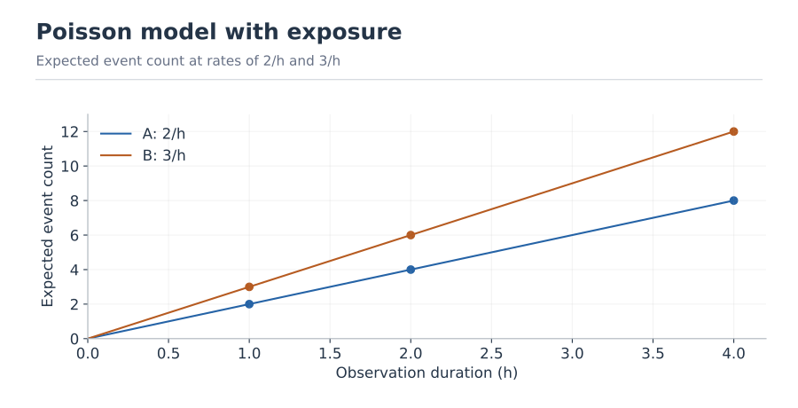

# M8-L5 – Poisson models and count data {#L5}

**Course area:** M8 – Regression and statistical models

**Level:** Bachelor · Core/Fundamentals

**Prerequisites:** [M4-L2](M4-L2.md) and [M8-L4](M8-L4.md).

**Learning objective:** Model counts and event rates using Poisson regression and recognise overdispersion.

## Counts rather than continuous measurements {#S1}

A monitoring service counts repeated failed read attempts within time intervals. For $Y\in\{0,1,2,\ldots\}$, the Poisson distribution provides a basic model:

$$P(Y=k\mid x)=\frac{e^{-\mu}\mu^k}{k!},\qquad E(Y\mid x)=\operatorname{Var}(Y\mid x)=\mu.$$

In a Poisson GLM with a log link, $\log\mu=x^T\beta$ and hence $\mu=\exp(x^T\beta)>0$. A coefficient changes the expected count multiplicatively. The model mean itself need not be an integer. For conditionally independent counts, the log-likelihood is $\sum_i[y_i\log\mu_i-\mu_i-\log(y_i!)]$. Estimation and model-based uncertainty measures follow from it; for small datasets, approximations using asymptotic tests should be treated with caution.

## Observation duration as an offset {#S2}

*Figure: Poisson model with exposure.*

If a system is monitored for twice as long, twice as many events are expected at an unchanged rate. With exposure $t_i>0$ (here in hours), we model the rate $r_i$ per hour by

$$\mu_i=t_ir_i,\qquad \log\mu_i=\log t_i+\beta_0+\beta_1d_i.$$

The offset $\log t_i$ has a fixed coefficient of one; it is not a freely estimated effect. Here exposure is expressed numerically in hours. In our teaching model, $\beta_0=\log 2$ and $\beta_1=\log 1.5$. System A ($d=0$) has a rate of 2/h, system B ($d=1$) a rate of 3/h. For 1, 2 and 4 hours, the expected counts for A are 2, 4, 8 and for B 3, 6, 12. The graphic compares both rates as the observation duration increases. B has a 50% higher rate in the model, not always one more event. When the actual observation duration is zero, the log offset is undefined; structural absence of exposure must be handled separately.

## Model limitations {#S3}

The Poisson assumption requires the conditional variance to equal the conditional mean. Higher variance (overdispersion) may arise from unobserved differences, clusters of failures or dependence. Diagnostics include Pearson residuals $(y_i-\hat\mu_i)/\sqrt{\hat\mu_i}$ and the sum of their squares divided by the residual degrees of freedom. Substantially elevated values call for investigation of the causes rather than automatic selection of a new distribution. The negative binomial distribution can, for example, allow $\operatorname{Var}(Y\mid x)=\mu+\alpha\mu^2$ with $\alpha>0$. Where special mechanisms produce zeros, hurdle or zero-inflated models may be appropriate. Not every large number of zeros is unusual: for $\mu=0.5$, $P(Y=0)=e^{-0.5}\approx0.6065$.

## Exercise and solution {#S4}

A reports 12 events in 4 hours; B reports 15 in 10 hours. Compare the observed rates and their ratio B/A. Solution: 3/h and 1.5/h; B/A = 0.5. Simply comparing 15 with 12 reverses the direction. For inferential statements, consider sample size, model and uncertainty.

## Sources and further reading {#S5}

- [statsmodels: Generalized Linear Models, Technical Documentation](https://www.statsmodels.org/stable/glm.html) – **Verification:** pending.
- [Penn State STAT 504: Poisson Regression](https://online.stat.psu.edu/stat504/Lesson09) – **Verification:** pending.
