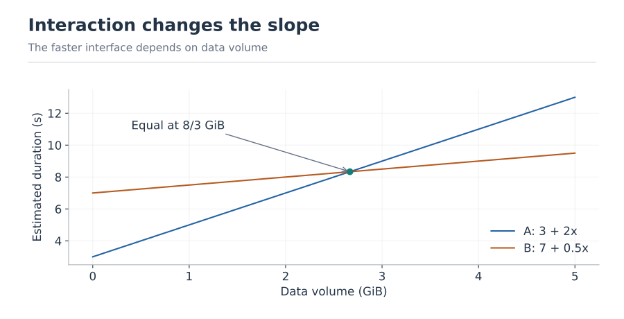

# M8-L6 – Interactions, non-linearity and transformations {#L6}

**Course area:** M8 – Regression and statistical models

**Level:** Bachelor · Core/Fundamentals

**Prerequisites:** [M8-L1](M8-L1.md), [M8-L2](M8-L2.md) and [M8-L3](M8-L3.md).

**Learning objective:** Model different slopes and curved relationships, and correctly back-transform a logarithmic response.

## Interactions rather than parallel lines {#S1}

Interfaces A and B may be similarly fast for small files but behave very differently for large files. In $\hat y=\beta_0+\beta_1x+\beta_2d+\beta_3xd$, the slope for A ($d=0$) is $\beta_1$, and for B it is $\beta_1+\beta_3$. The difference B minus A is $\beta_2+\beta_3x$. Thus an interaction coefficient does not simply change the intercept. Usually the corresponding main effects are retained in the model. With centring $x_c=x-x_0$, the group main effect refers to $x_0$ rather than zero.

## Non-linear in x, linear in the parameters {#S2}

*Figure: Interaction changes the slope.*

Our own teaching model is $\hat y=3+2x+4d-1.5xd$ (seconds, $x$ in GiB). A has the line $3+2x$, B the line $7+0.5x$. The two intersect at $x=4/1.5=8/3$ GiB and a duration of $25/3$ s. The graphic shows the intersection and different slopes. A single average group ratio would conceal this structure.

Curvature can be modelled with a polynomial $\beta_0+\beta_1x+\beta_2x^2$. It is linear in the unknown coefficients and can be estimated using OLS. The local slope is $\beta_1+2\beta_2x$. Flexible alternatives are splines: piecewise polynomials whose values and derivatives match at knots, depending on the construction. More degrees of freedom can reduce training residuals while worsening generalisation. The selection and knots must not be optimised using the final test set.

## Transformation and back-transformation {#S3}

For positive responses, a model for $Z=\log Y$ can represent a multiplicative structure. Example: $E(Z\mid x)=a+bx$. Then $e^b$ is the factor by which the conditional geometric mean changes per unit of $x$. With a conditionally normal error $\varepsilon$ on the log scale and constant variance $\sigma^2$,

$$E(Y\mid x)=\exp(a+bx+\sigma^2/2).$$

This follows because $E(e^\varepsilon)=e^{\sigma^2/2}$. Simply exponentiating the log prediction gives the median in this special case, not the arithmetic mean. For $a+bx=\log 10$ and $\sigma=0.4$, the median is 10 and the mean is $10e^{0.08}\approx10.83$. Without normality, a suitable empirical back-transformation factor may be required; with changing variance this factor may also depend on $x$. Zeros and negative values require a different modelling approach. The logarithm of a quantity with units is understood as the logarithm of its numerical value in a specified unit.

## Exercise and solution {#S4}

Calculate the group difference B minus A in the teaching model at 1 and 4 GiB. Solution: $4-1.5=2.5$ s at 1 GiB, $4-6=-2$ s at 4 GiB. Which group is faster depends on file size. Extrapolation beyond the measured range remains uncertain.

## Sources and further reading {#S5}

- [Penn State STAT 501: Categorical Predictors](https://online.stat.psu.edu/stat501/Lesson08) – **Verification:** pending.
- [Penn State STAT 501: Data Transformations](https://online.stat.psu.edu/stat501/Lesson09) – **Verification:** pending.
- [NIST/SEMATECH e-Handbook: Linear Least Squares Regression](https://www.itl.nist.gov/div898/handbook/pmd/section1/pmd141.htm) – **Verification:** pending.
