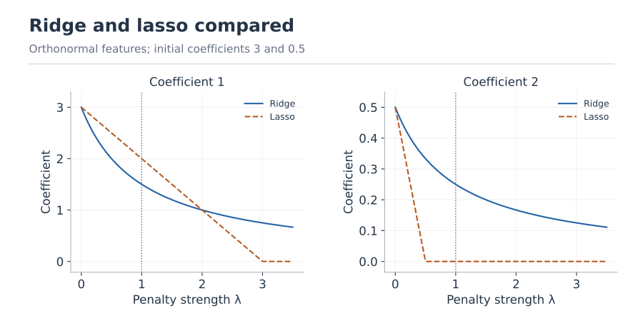

# M8-L7 – Regularisation with ridge and lasso {#L7}

**Course area:** M8 – Regression and statistical models

**Level:** Bachelor · Core/Fundamentals

**Prerequisites:** [M8-L2](M8-L2.md), [M2-L5](M2-L5.md), [M2-L6](M2-L6.md) and [M6-L2](M6-L2.md).

**Learning objective:** Distinguish L1 and L2 penalties mathematically and select regularisation strength without test data leakage.

## Why constrain coefficients? {#S1}

A model with many correlated sensor features may respond to small changes in the data with large changes in coefficients. Regularisation adds a cost function for the coefficients to the fitting error. For centred responses and centred, appropriately scaled features, we examine the following two objectives with $\lambda\geq0$:

$$J_R(w)=\frac12\|y-Xw\|_2^2+\frac\lambda2\|w\|_2^2,$$

$$J_L(w)=\frac12\|y-Xw\|_2^2+\lambda\sum_j|w_j|.$$

A separate intercept is usually not penalised. The exact normalisation (for example, division of the data error by $n$) differs between libraries. Numerical values of $\lambda$ must therefore not be transferred without checking. Ridge (L2) stabilises through continuous shrinkage; lasso (L1) can set coefficients exactly to zero, yielding sparse models.

## An orthonormal teaching example {#S2}




*Figure: Ridge and lasso compared.*

For ridge, $X^T(Xw-y)+\lambda w=0$ gives the solution $w_R=(X^TX+\lambda I)^{-1}X^Ty$ when $\lambda>0$. If $X^TX=I$ and $z=X^Ty$, the component-wise result is $w_{R,j}=z_j/(1+\lambda)$. For lasso, up to a constant, the objective reduces to $\sum_j[(w_j-z_j)^2/2+\lambda|w_j|]$. Separate derivatives arise for positive and negative $w_j$; at zero the subdifferential of the penalty lies in the interval $[-\lambda,\lambda]$. This gives the soft threshold

$$w_{L,j}=\operatorname{sgn}(z_j)\max(|z_j|-\lambda,0).$$

With $z=(3,0.5)^T$ and $\lambda=1$, ridge yields $(1.5,0.25)^T$ and lasso $(2,0)^T$. The graphic traces both pairs of coefficients at different strengths. With correlated columns, the separate threshold formula does not directly apply to the overall solution; coordinate descent solves subproblems instead. With strongly correlated features, selection by lasso may be unstable; elastic net combines both types of penalty.

## Hyperparameters without information leakage {#S3}

Choose $\lambda$ using validation data or cross-validation. Means and scaling are learnt within each training fold and then applied to its validation fold. A separate test set remains untouched until the end. For time series and repeated device measurements, folds must respect temporal or group boundaries. Regularisation often trades some bias for lower estimation variance. This is a trade-off, not a guarantee of better results. A selected feature is not automatically causal or statistically significant.

```python
import numpy as np
# Zwei zentrierte orthonormale Merkmale
X = np.array([[1,1],[-1,1],[1,-1],[-1,-1]]) / 2
z = np.array([3., .5])
y = X @ z
lam = 1.
ridge = np.linalg.solve(X.T@X + lam*np.eye(2), X.T@y)
lasso = np.sign(z)*np.maximum(np.abs(z)-lam,0)
assert np.allclose(ridge,[1.5,.25])
assert np.allclose(lasso,[2.,0.])
```

## Exercise and solution {#S4}

What happens in the orthonormal teaching example at $\lambda=3$? Solution: ridge yields $(0.75,0.125)$, lasso $(0,0)$. This applies to the normalisation defined here. Comparing only the training error would often lead to selecting too little regularisation.

## Sources and further reading {#S5}

- [scikit-learn: Linear Models, Ridge / Lasso](https://scikit-learn.org/stable/modules/linear_model.html) – **Verification:** pending.
