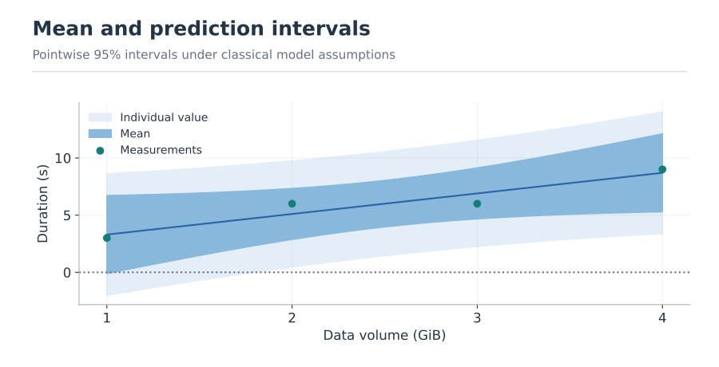

# M8-L8 – Prediction intervals and limits of interpretation {#L8}

**Course area:** M8 – Regression and statistical models

**Level:** Bachelor · Core/Fundamentals

**Prerequisites:** [M8-L1](M8-L1.md), [M8-L3](M8-L3.md) and [M6-L4](M6-L4.md).

**Learning objective:** Distinguish uncertainty about the mean from uncertainty about an individual observation and report regression results appropriately.

## Two different prediction questions {#S1}

An operator wants to know both the average read duration for a given data volume and how much the duration may vary on the next individual operation. The conditional mean and a future individual value are different quantities of interest. For simple linear regression with normally distributed, independent errors of equal variance and fixed $x$, the following holds for a new $x_0$:

$$h_0=\frac1n+\frac{(x_0-\bar x)^2}{\sum_i(x_i-\bar x)^2},\qquad s=\sqrt{\frac{\sum_i e_i^2}{n-2}}.$$

The standard deviation of the estimated mean is estimated by $s\sqrt{h_0}$. The prediction error additionally includes independent variation in the new operation: $s\sqrt{1+h_0}$. This gives the pointwise intervals at confidence level $1-\alpha$ with $c=t_{n-2,1-\alpha/2}$:

$$I_M=\hat y_0\pm c s\sqrt{h_0},\qquad I_P=\hat y_0\pm c s\sqrt{1+h_0}.$$

The formulae apply to a point specified in advance, not to a simultaneous band over arbitrarily many points. With multiple predictors, $x_0^T(X^TX)^{-1}x_0$ replaces $h_0$ (with a one in the design vector and full rank); the degrees of freedom are then $n-q$.

## Read duration in the teaching dataset {#S2}




*Figure: Mean and prediction intervals.*

We use the four measurements from [M8-L1](M8-L1.md) with $b_0=1.5$, $b_1=1.8$, $s^2=0.9$. At $x_0=2.5$ GiB, $\hat y_0=6$ s, $h_0=0.25$, $c\approx4.303$ for 95% and two degrees of freedom. Rounded, the interval for the mean is [3.96, 8.04] s; the prediction interval is [1.44, 10.56] s. The graphic shows both families of pointwise intervals over the observed range. The small sample gives wide intervals. Negative lower bounds may occur for other inputs; this would indicate limitations of the normally distributed model for positive durations.

```python
import numpy as np
from scipy.stats import t
s = np.sqrt(.9)
c = t.ppf(.975, 2)
h = .25
mean_ci = 6 + np.array([-1,1])*c*s*np.sqrt(h)
pred_pi = 6 + np.array([-1,1])*c*s*np.sqrt(1+h)
print(mean_ci, pred_pi)
```

## Interpretation and reporting {#S3}

Under the model assumptions, a classical 95% confidence procedure covers the fixed true mean in 95% of repeated samples. A 95% prediction procedure covers the new value with the corresponding probability when the interval is constructed repeatedly and a new observation is made. Neither guarantees coverage for this particular case. Report units, data range, sample size, model form, estimation uncertainty and diagnostic results. Outside the observed range the linear structure may fail, regardless of the calculated interval width. Repeated measurements within a device are not necessarily independent; changing the device may alter the distribution. Coefficients describe conditional associations unless a sound causal design is in place.

## Exercise and solution {#S4}

Calculate $h_0$ for 4 GiB and compare it with the centre. Solution: $0.25+(4-2.5)^2/5=0.7$. Both types of interval become wider at the edge; at the same $x_0$ the prediction interval remains wider than the interval for the mean. The assessment of uncertainty also depends on the validity of the error model and mean model.

## Sources and further reading {#S5}

- [NIST/SEMATECH e-Handbook: Average response](https://www.itl.nist.gov/div898/handbook/pmd/section5/pmd511.htm) – **Verification:** pending.
- [NIST/SEMATECH e-Handbook: Prediction of a single response](https://itl.nist.gov/div898/handbook/pmd/section5/pmd512.htm) – **Verification:** pending.
