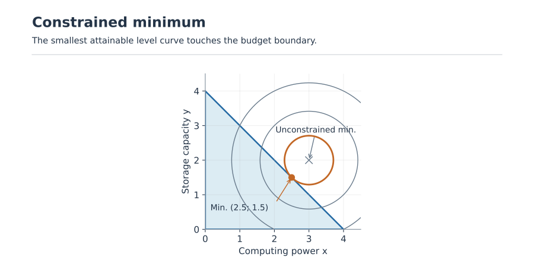

# M9-L1 – Objective functions, constraints and optimality {#L1}

**Course area:** M9 – Numerical methods and optimisation for learning algorithms

**Level:** Bachelor · Core/compulsory elective

**Prerequisites:** [M2-L3](M2-L3.md), [M2-L5](M2-L5.md), [M8-L1](M8-L1.md).

**Learning objective:** Distinguish objective functions, feasible sets and optimality conditions.

## From a learning problem to a mathematical task {#S1}

A data platform must set two control variables: $x$ for computing power and $y$ for storage capacity, both in normalised capacity units. A synthetic cost function $f(x,y)$ evaluates a setting, not the probability that it is correct. Optimisation means finding the feasible setting with the smallest value. Model training, for example, replaces the cost with an empirical prediction loss plus regularisation. The choice of objective function remains a modelling decision: minimising computing time may conflict with reliability or energy consumption.

The general notation is $\min_{z\in C} f(z)$. The feasible set $C$ is determined by equations $h_j(z)=0$, inequalities $g_i(z)\le 0$ and, where applicable, discrete requirements. A minimum is global if $f(z^*)\le f(z)$ holds for every $z\in C$; a local minimum need only satisfy the condition in a neighbourhood within $C$. Existence is not automatic: on the open interval $(0,1)$, $f(x)=x$ has an infimum of zero but no minimiser.

## Geometry of a constrained problem {#S2}

*Figure: Constrained minimum.*

In the teaching example, let $f(x,y)=(x-3)^2+(y-2)^2$ subject to $x,y\ge0$ and $x+y\le4$. The level curves are circles centred on $(3,2)$; the unconstrained optimum is infeasible. The nearest point of the triangle on $x+y=4$ is obtained by subtracting $(0.5,0.5)$ from the centre. The solution is therefore $(2.5,1.5)$ with $f=0.5$. The diagram shows how the smallest attainable level curve touches the boundary. A feasible boundary point need not have a vanishing gradient.

## Stationarity and curvature {#S3}

At an interior local minimum of a differentiable function, $\nabla f(z^*)=0$ is necessary. The second derivative helps distinguish cases: for $f(x)=x^3$, zero is stationary but not an extremum; for $f(x)=-x^2$, zero is a maximum. A positive definite Hessian at a stationary point of a twice continuously differentiable function guarantees a strict local minimum. For convex functions, stationarity suffices for global optimality. With several local minima, however, a general numerical solver often returns only a candidate.

At the constrained solution, $\nabla f=(-1,-1)^T$. The negative gradient direction would violate the budget. Along the boundary line, its scalar product with the feasible tangent vector $(1,-1)^T$ is zero. The boundary condition replaces unconstrained stationarity here (see [M9-L4](M9-L4.md)).

## Exercise and solution {#S4}

Increase the budget to 4.6 units. The centre uses 5 units in total, so subtract 0.2 from both coordinates. The solution is $(2.8,1.8)$ with an objective value of 0.08. With a budget of 5 or more, the centre itself is feasible. A higher budget does not improve this objective function.

## Sources and further reading {#S5}

- [Boyd/Vandenberghe: Convex Optimization (2004), Ch. 2–5, 9–11](https://web.stanford.edu/~boyd/cvxbook/) – **Verification:** pending.
- [Cornell CS 4/5780: Gradient Descent (and Beyond)](https://www.cs.cornell.edu/courses/cs3780/2026sp/lectures/lecturenote07.html) – **Verification:** pending.
