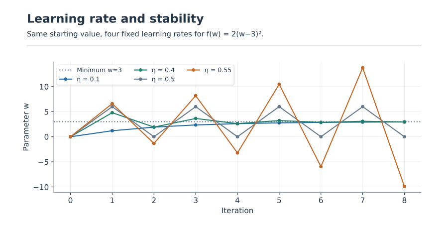

# M9-L2 – Gradient methods and learning rates {#L2}

**Course area:** M9 – Numerical methods and optimisation for learning algorithms

**Level:** Bachelor · Core/compulsory elective

**Prerequisites:** [M2-L4](M2-L4.md), [M2-L5](M2-L5.md), [M9-L1](M9-L1.md).

**Learning objective:** Calculate gradient steps and assess stable learning rates for quadratic problems.

## The direction of steepest local descent {#S1}

For a differentiable function, the Taylor approximation gives $f(w+d)\approx f(w)+\nabla f(w)^Td$. Among directions with Euclidean norm one, the direction opposite to the normalised gradient minimises this linear expression. This gives the gradient descent method:

$$w_{k+1}=w_k-\eta_k\nabla f(w_k),\qquad \eta_k>0.$$

The gradient determines the direction; the learning rate $\eta_k$ determines the step length relative to its magnitude. Different parameter scales change this geometry. A step is a local decision, not a guarantee of finding the global minimum.

## Learning rate in a verifiable example {#S2}




*Figure: Learning rate and stability.*

For $f(w)=2(w-3)^2$, we have $f'(w)=4(w-3)$. The error $e_k=w_k-3$ obeys $e_{k+1}=(1-4\eta)e_k$. From $|1-4\eta|<1$ it follows that $0<\eta<0.5$. Starting at $w_0=0$ with $\eta=0.1$, the first two values are 1.2 and 1.92; with 0.4 they are 4.8 and 1.92. Both methods reduce the magnitude of the error by a factor of 0.6, but only the second alternates sides. At 0.5 the parameter oscillates between zero and six; above this rate the error grows. The diagram shows the different trajectories, including divergence.

For a multidimensional quadratic problem $f(w)=\frac12(w-w^*)^TH(w-w^*)$ with symmetric positive definite $H$, each eigendirection has its own factor $1-\eta\lambda_i$. A fixed positive learning rate smaller than $2/\lambda_{\max}$ guarantees convergence. If the eigenvalues differ greatly, the slow direction may require many steps.

## Implementation and step selection {#S3}

```python
import numpy as np
w = 0.
for k in range(20):
    w -= .1 * 4 * (w - 3)
assert np.isclose(w, 3 - 3 * .6**20)
```

A backtracking line search initially selects a larger step size and reduces it until, for example, the Armijo condition $f(w+\eta d)\le f(w)+c\eta\nabla f(w)^Td$ with $0<c<1$ holds. Here $d$ must be a descent direction. For expensive data losses, the additional evaluations cost computing time; with changing mini-batches, a direct comparison is noisy. Scaled features, sensible initial values and limited step counts improve practical robustness.

## Exercise and solution {#S4}

Which constant learning rate reaches the minimum in one step in the scalar example? With $\eta=1/4$ the error factor becomes zero. This value cannot be transferred to an arbitrary non-quadratic problem. For highly anisotropic functions, a single learning rate is a compromise.

## Sources and further reading {#S5}

- [Cornell CS 4/5780: Gradient Descent (and Beyond)](https://www.cs.cornell.edu/courses/cs3780/2026sp/lectures/lecturenote07.html) – **Verification:** pending.
- [UC Berkeley STAT 243: Optimization (2024)](https://stat243.berkeley.edu/fall-2024/units/unit11-optim.html) – **Verification:** pending.
