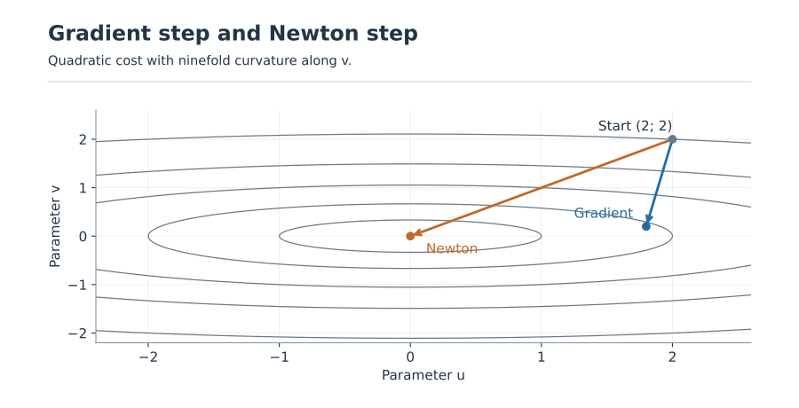

# M9-L3 – Newton and quasi-Newton methods {#L3}

**Course area:** M9 – Numerical methods and optimisation for learning algorithms

**Level:** Bachelor · Core/compulsory elective

**Prerequisites:** [M2-L5](M2-L5.md), [M2-L6](M2-L6.md), [M9-L2](M9-L2.md).

**Learning objective:** Derive Newton and quasi-Newton steps and understand their limitations.

## Curvature as additional information {#S1}

The gradient indicates how steeply the objective function rises at the current point. Newton's method also uses the local change in that gradient. The quadratic approximation is

$$q(d)=f(w)+g^Td+\frac12d^THd,\quad g=\nabla f(w),\quad H=\nabla^2 f(w).$$

For positive definite $H$, this approximation has the unique minimum given by $Hd=-g$. Solve the linear system rather than explicitly computing the inverse matrix. The step is $w_{k+1}=w_k+\alpha d$; pure Newton uses $\alpha=1$. Near a regular minimum, Newton's method can converge quadratically under sufficiently smooth curvature. Outside that neighbourhood, safeguards are needed.

## Worked example: adjusting two parameters {#S2}




*Figure: Gradient step and Newton step.*

Let $f(u,v)=\frac12(u^2+9v^2)$ and start at $(2,2)$. The gradient $(2,18)^T$ and Hessian $\operatorname{diag}(1,9)$ give $d=(-2,-2)^T$. The objective is exactly quadratic; Newton reaches $(0,0)$ immediately. A gradient step with $\eta=0.1$ instead reaches $(1.8,0.2)$. The diagram shows the markedly different curvatures and the first movement of both methods. For a general function, the Hessian can be indefinite or singular. The computed Newton step may then go uphill or be undefined.

## BFGS and limited memory {#S3}

Quasi-Newton methods learn curvature from successive gradients. For $s=w_{k+1}-w_k$, $y=g_{k+1}-g_k$ and $\rho=(y^Ts)^{-1}$, the inverse BFGS update is:

$$B_{k+1}=(I-\rho sy^T)B_k(I-\rho ys^T)+\rho ss^T.$$

$B$ approximates the inverse Hessian. If $B_k$ is positive definite and $y^Ts>0$, the next approximation remains positive definite; the direction $-B_{k+1}g_{k+1}$ is a descent direction for a non-zero gradient. Suitable line searches, damping or skipped updates help when curvature values are problematic. Dense BFGS requires memory quadratic in the number of parameters. L-BFGS retains only a limited number of vector pairs and is therefore attractive for large smooth problems.

```python
import numpy as np
from scipy.optimize import minimize
H = np.diag([1., 9.])
f = lambda w: .5 * w @ H @ w
g = lambda w: H @ w
w = np.array([2., 2.])
assert np.allclose(w + np.linalg.solve(H, -g(w)), 0)
res = minimize(f, w, jac=g, method='BFGS')
assert res.success and np.linalg.norm(res.x) < 1e-5
```

## Exercise and solution {#S4}

For $s=(1,0)^T$, $y=(2,0)^T$ and $B_0=I$, we have $\rho=1/2$. Both bracketed factors are diagonal with entries zero and one. The last summand contributes 0.5 to the first diagonal element. Thus $B_1=\operatorname{diag}(0.5,1)$. The observed curvature of two is correctly inverted along the first direction.

## Sources and further reading {#S5}

- [Cornell CS 4/5780: Gradient Descent (and Beyond)](https://www.cs.cornell.edu/courses/cs3780/2026sp/lectures/lecturenote07.html) – **Verification:** pending.
- [UC Berkeley STAT 243: Optimization (2024)](https://stat243.berkeley.edu/fall-2024/units/unit11-optim.html) – **Verification:** pending.
- [A. Honkela, Computational Statistics I: Automatic differentiation and optimisation](https://www.cs.helsinki.fi/u/ahonkela/teaching/compstats1/book/automatic-differentiation-and-optimisation.html) – **Verification:** pending.
