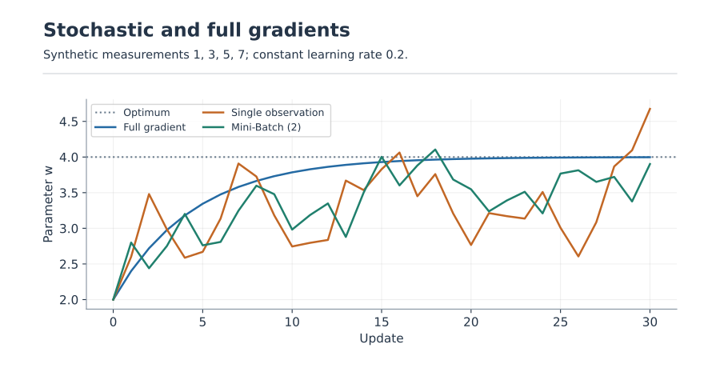

# M9-L5 – Stochastic gradients and mini-batches {#L5}

**Course area:** M9 – Numerical methods and optimisation for learning algorithms

**Level:** Bachelor · Core/compulsory elective

**Prerequisites:** [M4-L4](M4-L4.md), [M6-L2](M6-L2.md), [M9-L2](M9-L2.md).

**Learning objective:** Calculate mini-batch gradients and explain their trade-off between computational cost and variance.

## When the full gradient becomes too expensive {#S1}

Many learning problems minimise the mean of individual losses $F(w)=\frac1n\sum_{i=1}^n\ell_i(w)$. The full gradient requires all $n$ contributions. If instead we draw $b$ independent indices $I_j$ uniformly with replacement, we obtain

$$\hat g_B(w)=\frac1b\sum_{j=1}^b\nabla\ell_{I_j}(w).$$

For fixed $w$, $E(\hat g_B)=\nabla F(w)$. The covariance of the mean is then $\Sigma(w)/b$, where $\Sigma$ denotes the covariance of a single random gradient. Sampling without replacement requires a different finite population correction; unequal sampling probabilities require appropriate weights. An update with $w^+=w-\eta\hat g_B$ can also increase the total loss.

## Calculating a small data model in full {#S2}




*Figure: Stochastic and full gradients.*

We estimate a typical duration from four normalised measurements $a=(1,3,5,7)$ with $\ell_i(w)=\frac12(w-a_i)^2$. The minimum of the mean cost occurs at $w^*=4$. At $w=2$, the individual gradients are $(1,-1,-3,-5)$, their mean is minus two and their population variance is five. A single observation therefore gives variance 5, whereas an independent batch of four draws gives variance 1.25. A batch containing measurements one and seven has gradient minus two. For $\eta=0.2$ it gives $w^+=2.4$.

The diagram shows three trajectories calculated from the same starting point: the full gradient, individual random observations and mini-batches. With a constant learning rate, noise remains visible especially near the optimum. The particular realisation depends on the random seed.

## Computing time, epochs and learning rates {#S3}

```python
import numpy as np
rng = np.random.default_rng(17)
a = np.array([1., 3., 5., 7.])
w = 2.
for k in range(200):
    batch = rng.choice(a, size=2, replace=True)
    w -= (1 / (k + 5)) * (w - batch).mean()
assert abs(w - 4) < .5
```

An epoch corresponds to one pass through the training set; when sampling with replacement it often means only a nominal $n$ processed examples. Compare methods by the number of processed data points and runtime, not just updates: a batch can be computed in parallel and achieves lower variance, but requires more computation. Decreasing learning rates can dampen noise over time; for classical stochastic approximation, under further assumptions, $\sum_k\eta_k=\infty$ and $\sum_k\eta_k^2<\infty$ are common conditions. Validation data must not be used to form gradients.

## Exercise and solution {#S4}

What is the variance of the batch gradient for two independent draws? $5/2=2.5$. If all four measurements are processed exactly once instead of drawing four randomly, the full gradient is exact and its sampling variance is zero.

## Sources and further reading {#S5}

- [UC Berkeley STAT 243: Optimization (2024)](https://stat243.berkeley.edu/fall-2024/units/unit11-optim.html) – **Verification:** pending.
- [A. Honkela, Computational Statistics I: Automatic differentiation and optimisation](https://www.cs.helsinki.fi/u/ahonkela/teaching/compstats1/book/automatic-differentiation-and-optimisation.html) – **Verification:** pending.
