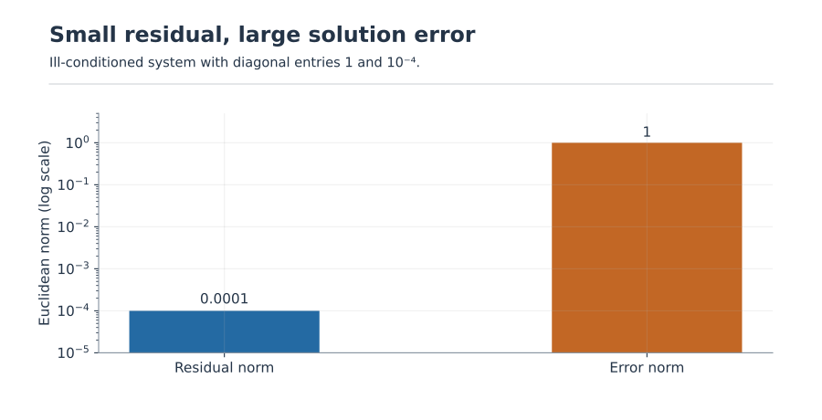

# M9-L6 – Numerical methods for large systems and approximation {#L6}

**Course area:** M9 – Numerical methods and optimisation for learning algorithms

**Level:** Bachelor · Core/compulsory elective

**Prerequisites:** [M2-L1](M2-L1.md), [M2-L4](M2-L4.md), [M2-L7](M2-L7.md), [M3-L3](M3-L3.md), [M9-L3](M9-L3.md).

**Learning objective:** Distinguish conditioning, iterative linear solvers and low-rank approximation.

## A large system of equations is not a small matrix {#S1}

Linear systems $Ax=b$ occur, for example, in Newton steps or model fitting. A dense matrix of $d^2$ double-precision values requires $8d^2$ bytes. For $d=100000$, this is 80 billion bytes (80 GB decimal), excluding vectors and working copies. If only nearby neighbours are connected, sparse storage can be considerably smaller. An operator may need only a function that computes $Av$ without explicitly constructing $A$.

## Residual, error and conditioning {#S2}




*Figure: Small residual, large solution error.*

For an approximation $\tilde x$, the residual is $r=b-A\tilde x$; the solution error is $x-\tilde x=A^{-1}r$. For an invertible matrix, the condition number $\kappa_2(A)=\sigma_{\max}/\sigma_{\min}$ explains why a small relative residual does not always guarantee a small relative solution error. For $A=\operatorname{diag}(1,10^{-4})$, $b=(1,10^{-4})^T$, $x=(1,1)^T$ and $\tilde x=(1,0)^T$, the residual norm is $10^{-4}$ but the error norm is one; the condition number is 10,000. The diagram contrasts the two quantities. With full column rank, $A^TA$ has the squared 2-norm condition number of $A$; normal equations are therefore often unsuitable for ill-conditioned least-squares problems.

## Iterative solvers and approximate models {#S3}

For symmetric positive definite matrices, the conjugate gradient method uses search directions orthogonal with respect to $A$. It needs matrix-vector products rather than dense factorisation. In exact arithmetic it solves a $d$-dimensional system in at most $d$ steps; in practice, a residual tolerance governs termination. A positive definite preconditioner, for example a suitable diagonal approximation to the inverse, can improve convergence. LSQR handles large rectangular least-squares systems using products with $A$ and $A^T$.

```python
import numpy as np
from scipy.sparse import diags
from scipy.sparse.linalg import cg
A = diags([2., 4., 8.], format='csr')
b = np.array([2., 8., 24.])
x, status = cg(A, b, rtol=1e-10)
assert status == 0 and np.allclose(x, [1, 2, 3])
```

For a data matrix with singular values $\sigma_1\ge\cdots$, a rank-$k$ approximation $A_k=U_k\Sigma_k V_k^T$ can save memory. Its Frobenius error is $\sqrt{\sum_{i>k}\sigma_i^2}$. For singular values 9, 4 and 3, the error is five at rank one and three at rank two. Omitting small directions can also remove information about rare events; approximation quality is therefore not automatically prediction quality.

## Exercise and solution {#S4}

With one million degrees of freedom and five non-zero entries per row, the double-precision values alone occupy 40 MB (decimal); indices and row pointers are also required. Dense storage of the values alone would require 8 TB. The memory savings do not imply any fixed iteration count.

## Sources and further reading {#S5}

- [Boyd/Vandenberghe: Convex Optimization (2004), Ch. 2–5, 9–11](https://web.stanford.edu/~boyd/cvxbook/) – **Verification:** pending.
- [SciPy: cg](https://docs.scipy.org/doc/scipy/reference/generated/scipy.sparse.linalg.cg.html) – **Verification:** pending.
- [SciPy: lsqr](https://docs.scipy.org/doc/scipy/reference/generated/scipy.sparse.linalg.lsqr.html) – **Verification:** pending.
