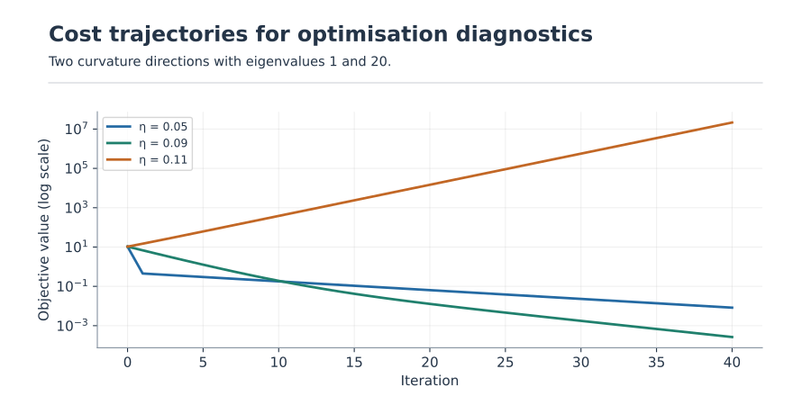

# M9-L7 – Optimisation diagnostics and comparison of methods {#L7}

**Course area:** M9 – Numerical methods and optimisation for learning algorithms

**Level:** Bachelor · Core/compulsory elective

**Prerequisites:** [M6-L2](M6-L2.md), [M9-L2](M9-L2.md), [M9-L5](M9-L5.md).

**Learning objective:** Diagnose optimisation trajectories and plan fair comparisons of methods.

## Convergence is not the same as generalisation {#S1}

A learning procedure can stop for several reasons: the solver reaches a stationary optimum, a step limit, a numerical error or a validation criterion. These cases must be logged separately. For a smooth unconstrained problem, suitable indicators include the gradient norm, absolute or relative function change and step norm. A feasible optimisation point on the boundary may have a large gradient; projected or KKT residuals are then needed. A small step size may also arise from an excessively small learning rate.

A relative change criterion can be defined as $|f_{k+1}-f_k|/\max(1,|f_k|)$. Together with an absolute gradient criterion and a maximum number of iterations, it prevents some erroneous success reports. The numerical scale and units of the parameters must match the tolerances. Checking for finite values detects overflows, NaNs and invalid function domains.

## Diagnostics for two coupled directions {#S2}




*Figure: Cost trajectories for optimisation diagnostics.*

For $f(u,v)=\frac12(u^2+20v^2)$, starting at $(1,1)$, a gradient step is $(u^+,v^+)=((1-\eta)u,(1-20\eta)v)$. With $\eta=0.05$ the second coordinate vanishes after one step, while the first shrinks slowly by a factor of 0.95. With $\eta=0.09$ the second factor is minus 0.8; the costs initially decrease faster or slower depending on the direction. With $\eta=0.11$ the magnitude of the second factor is 1.2: the costs eventually increase. The diagram shows the actual losses on a logarithmic axis. A single first step or the step norm is insufficient for diagnosis.

## Reproducible comparison protocols {#S3}

```python
import numpy as np
H = np.diag([1., 20.])
for eta in [.05, .09, .11]:
    w = np.ones(2)
    history = []
    for k in range(41):
        history.append(.5 * w @ H @ w)
        w -= eta * (H @ w)
    assert np.isfinite(history).all()
    print(eta, history[-1])
```

For a fair empirical comparison, fix the data split, objective and regularisation, initialisation distribution, hardware, numerical precision and stopping rules. Record runtime, the number of function and gradient evaluations, data points, peak memory and the achieved loss. Randomised methods require repetitions with predetermined seeds and measures of dispersion. Assess model quality using separate validation data, and use a held-out test set only after selection. Early stopping serves a generalisation objective and is not proof of numerical convergence.

## Exercise and solution {#S4}

One method uses 100 steps with 1,000 examples per step; another uses 400 steps with 100 examples. These correspond to 100,000 and 40,000 evaluated examples respectively. Which is faster? Without runtime and cost per example, this cannot be determined. Which generalises better? That too cannot be determined without comparison on separate data.

## Sources and further reading {#S5}

- [Cornell CS 4/5780: Gradient Descent (and Beyond)](https://www.cs.cornell.edu/courses/cs3780/2026sp/lectures/lecturenote07.html) – **Verification:** pending.
- [UC Berkeley STAT 243: Optimization (2024)](https://stat243.berkeley.edu/fall-2024/units/unit11-optim.html) – **Verification:** pending.
- [A. Honkela, Computational Statistics I: Automatic differentiation and optimisation](https://www.cs.helsinki.fi/u/ahonkela/teaching/compstats1/book/automatic-differentiation-and-optimisation.html) – **Verification:** pending.
