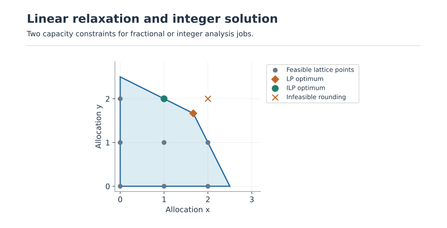

# M9-L8 – Linear and combinatorial optimisation for data problems {#L8}

**Course area:** M9 – Numerical methods and optimisation for learning algorithms

**Level:** Bachelor · Elective specialisation

**Prerequisites:** [M2-L1](M2-L1.md), [M9-L1](M9-L1.md), [M9-L4](M9-L4.md).

**Learning objective:** Model linear programmes and integer decisions and assess relaxation bounds.

## Resource allocation in a data platform {#S1}

In linear programming (LP), the objective function and constraints are linear. One application is selecting analysis jobs under limited hardware resources. If $x,y$ are divisible computing allocations, the utility $3x+4y$ is to be maximised. Memory and time requirements give $2x+y\le5$ and $x+2y\le5$ in the simplified teaching model, with $x,y\ge0$. The feasible set is a polyhedron. For a non-empty bounded polyhedron, a linear objective has at least one optimal vertex. Infeasible, unbounded or multiply optimal problems require separate treatment.

## From continuous to discrete decisions {#S2}




*Figure: Linear relaxation and integer solution.*

The vertices are $(0,0)$, $(2.5,0)$, $(5/3,5/3)$ and $(0,2.5)$. Their utilities are 0, 7.5, $35/3\approx11.667$ and 10. If only whole jobs are allowed, we instead obtain the integer linear programme (ILP) with $x,y\in\mathbb Z_{\ge0}$. The sole feasible lattice point with maximum value here is $(1,2)$ with eleven. Rounding the LP solution to $(2,2)$ violates both constraints. The diagram distinguishes the continuous feasible region and the feasible discrete points within it. For the maximisation problem, the LP value is an upper bound on the ILP value, not necessarily attainable.

## Solvers and combinatorial problems {#S3}

Branch-and-bound examines subproblems by branching on integer variables and using relaxed bounds to exclude unsuitable subregions. Cuts can add further valid inequalities. In a knapsack problem, for instance, $z_i\in\{0,1\}$ determines whether a dataset is selected; $\sum_i v_i z_i$ is maximised subject to $\sum_i c_i z_i\le B$. Assignment problems use binary variables to pair two sets, while flow problems use capacity and balance constraints. Not every combinatorial problem is equally difficult; polynomial-time algorithms exist for some special structures, but general integer optimisation can require exponential effort.

```python
import numpy as np
from scipy.optimize import linprog, milp, LinearConstraint
A = np.array([[2., 1.], [1., 2.]])
b = np.array([5., 5.])
c = np.array([-3., -4.])
lp = linprog(c, A_ub=A, b_ub=b, method='highs')
ilp = milp(c, integrality=[1, 1],
           constraints=LinearConstraint(A, -np.inf, b))
assert lp.success and ilp.success
assert np.isclose(-lp.fun, 35/3)
assert np.allclose(ilp.x, [1., 2.]) and np.isclose(-ilp.fun, 11)
```

The negative objective coefficients transform maximisation into minimisation. With time limits, a solver may return only an intermediate feasible solution. The status, bound and optimality gap are then more important than merely displaying a result.

## Exercise and solution {#S4}

Which allocations are still possible for $x=2$? The first constraint gives $y\le1$ and the second $y\le1.5$. Hence the maximum is $y=1$, with value ten. The alternative point $(1,2)$ is feasible and better. The absolute difference between the LP bound and the ILP solution is $35/3-11=2/3$.

## Sources and further reading {#S5}

- [Boyd/Vandenberghe: Convex Optimization (2004), Ch. 2–5, 9–11](https://web.stanford.edu/~boyd/cvxbook/) – **Verification:** pending.
- [SciPy: linprog](https://docs.scipy.org/doc/scipy/reference/generated/scipy.optimize.linprog.html) – **Verification:** pending.
- [SciPy: milp](https://docs.scipy.org/doc/scipy/reference/generated/scipy.optimize.milp.html) – **Verification:** pending.
